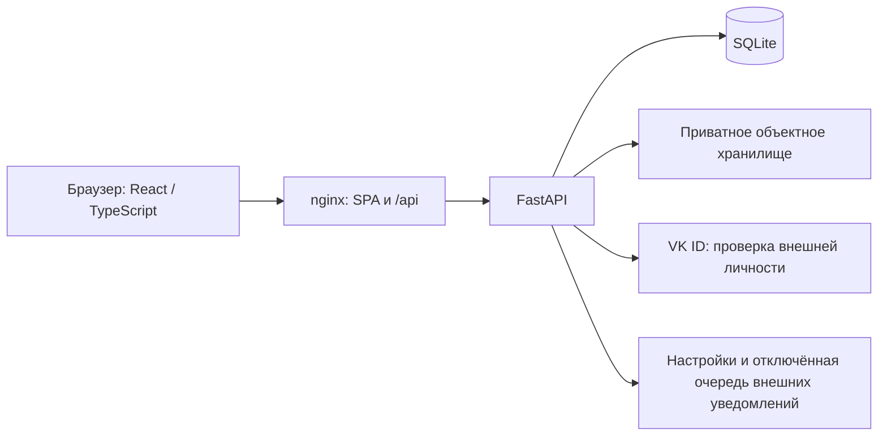

# Profkom Web: архитектура, требования и образ результата

Актуализировано 1 ноября 2026 года по локальному коду и согласованным решениям,
включая решения владельца по аудиту 31 октября и раскладку D-01–D-09 от 1 ноября.
Документ описывает продукт и его обязательные границы, а не состояние запущенного
сервера. Наличие функции в коде, локальная проверка, выкладка на тест и выпуск
в production — разные факты; у каждого должно быть собственное доказательство.

Навигация: [документация](docs/README.md) · [инструкция пользователю](docs/USER_GUIDE.md)
· [технические контракты](backend/docs/README.md) · история решений:
[30 октября](docs/decisions/2026-10-30-portal.md), [31 октября](docs/decisions/2026-10-31-qa-audit.md).

## 1. Для кого и какой результат нужен

Сайт — единое рабочее пространство Профкома ВМК. Активист видит свои дела и команды,
руководитель управляет работой в своей области, HR и руководство подводят итоги.
Базовая рабочая роль в мероприятии — **организатор**; участник мероприятия означает
его посетителя. Названия «мероприятие» и «подмероприятие» сохраняются.

Ожидаемый результат для пользователя:

- Начать день с коротких списков просроченных и ближайших задач, рядом — календарь на сегодня.
- Найти блок, человека, мероприятие, материал или очередь через поиск и фильтры.
- Выполнять совместную задачу: общий статус, чеклисты, комментарии, файлы и призывы.
- Руководителю — учитывать работу и исправлять оценки из самой задачи, а не искать
  отдельную устаревшую форму. Рабочее состояние задачи и ККР остаются независимыми.
- Получать понятные уведомления и видеть, кто и когда изменил данные.
- Отправить ошибку через жучка и продолжить обсуждение в своём тикете поддержки.

Интерфейс должен быть компактным, единообразным и удобным на desktop и mobile.
Создание начинается по явной кнопке и выглядит как незаполненная страница объекта;
чтение существующего объекта не включает редактирование автоматически.

## 2. Архитектура приложения

Внешние связи на схеме описывают архитектуру. Локальные проверки используют
одноразовую SQLite, синтетические аккаунты и подмены VK/хранилища.

| Слой | Ответственность и исходники |
| --- | --- |
| Frontend | React 19, TypeScript, Vite; маршруты и экраны в `frontend/src`, маршрутизатор и lazy-модули, TanStack Query, Formik/Zod, CSS Modules и общие токены |
| HTTP-контракт | `/api` в [main.py](backend/main.py), доменные маршруты, Pydantic; frontend DTO в [contract.ts](frontend/src/utils/api/contract.ts), клиенты `*.api.ts`; OpenAPI на `/openapi.json`. Служебный `/api/bot/v1` бота HereBot — отдельный роутер со своим токеном ([BOT_API](backend/docs/BOT_API.md)) |
| Права | [access.py](backend/access.py): центральная политика и отношения; доменные проверки уточняют доступ к очереди, задаче, файлу и закрытым данным; UI получает `capabilities` |
| Домен и данные | [database.py](backend/database.py), [domain_models.py](backend/domain_models.py), внутренние dataclass в [models.py](backend/models.py); доменные сервисы используют одну общую базу |
| Транзакции | `Database.async_atomic` для HTTP, `Database.atomic` для синхронных сервисов; ревизии и ограничения SQLite; ошибка одного элемента откатывает команду целиком |
| Файлы | [file_access.py](backend/file_access.py): контекст загрузки, проверка байтов, завершённый неизменяемый объект, актуальный ACL; доставка через защищённый same-origin URL |
| Локальная среда | Канонический checkout `profkom_web`; окружения, сборки и доказательства в игнорируемой `.local/`, без второй основной копии репозитория |

Схема расширяется идемпотентными startup-миграциями; Alembic сейчас не применяется.
Изменение модели проходит весь путь: БД → доменная модель → Pydantic → TypeScript
→ API-клиент → query cache → интерфейс и проверки. Ревизии публичной задачи,
приватного оценивания и сводной нельзя подменять друг другом.

## 3. Модель предметной области

- **Аккаунт и сессия:** регистрационное согласование, состояние аккаунта,
  явные роли, отзыв сессий. Членство, руководящая роль и допуск к задаче — разные связи.
- **Блок:** стабильный UUID, мастер, его заместители, HR-куратор и состав.
  Переименование не создаёт новый блок и не передаёт права однофамильцам.
- **Сезон:** планируемый / открытый / подведение итогов / закрытый. Текущий сезон
  и состояние сезона различаются; работа может относиться к разным незакрытым сезонам.
- **Мероприятие → подмероприятия:** равноправные главорги и ответственные,
  их заместители, организаторы, необязательные даты, отчёты и созвоны.
  HR назначается только подмероприятию. Уровни не переименовываются автоматически.
- **Очередь → задачи:** имя, неизменяемый буквенный ключ, владелец, источник работы
  и допуски. Ключ задачи — `КЛЮЧ-N`, технический UUID и прежние ссылки сохраняются.
- **Задача:** общий рабочий статус, автор, исполнители и наблюдатели, тип,
  приоритет, сроки, описание, файлы, чеклисты, связи и публичная история.
- **Приватный учёт:** личные назначения, часы, оценка, критерии, начисления,
  коэффициенты источников и утверждённые версии сезонной сводной.
- **Материал:** опубликованная версия отдельно от черновика; редакторы,
  вложения, история и корзина. Старые гайды имеют явное соответствие материалам.
- **Профиль:** контакты, аватар, действующие и прошлые роли, ручные достижения;
  настройки внешних уведомлений отдельно от просмотра профиля.
- **ПГАС и поддержка:** документы с периодом; обращения WEBSUPPORT с отдельными
  правами заявителя, сотрудников и приватной диагностикой.

## 4. Обязательные правила доступа

Права проверяет backend при каждом чтении и изменении; правила собраны в `POLICY`
[access.py](backend/access.py), кнопки интерфейса следуют `capabilities`. Название должности, ФИО,
старые флаги `admin`/`super_user` и прежняя роль не заменяют текущие назначения.
Отказ в доступе должен скрывать также старые данные и превью из frontend cache.
Команда к объекту, которого вызывающий не может прочитать, отвечает 404, как его GET,
раньше проверки права и ревизии; читатель без права на действие получает 403.

| Кто | Существенные права и ограничения |
| --- | --- |
| Активный одобренный аккаунт | Рабочие общедоступные разделы; состав и анонсы команд не открывают их задачи, созвоны, отчёты или ККР |
| Читатель / исполнитель задачи | Одинаковые базовые публичные права: рабочий статус, любые комментарии, галочки чеклистов, сдача результата, присоединение/наблюдение. Сами по себе эти роли не дают редактирование описания, типа, приоритета или ККР. В закрытом сезоне эти действия остаются, кроме присоединения, которому нужна новая строка учёта |
| Автор / уполномоченный редактор задачи | Описание, классификация, планирование и управление составом по capabilities и ограничениям сезона. Закрывает и переоткрывает автор; если он недоступен — владелец очереди с аудитом |
| Мастер / зам блока, главорг / зам, ответственный / зам | Управление своей областью; главорг работает и с дочерними подмероприятиями. Роль не становится глобальной |
| HR-куратор блока | ККР своего блока; не согласовывает заявки только на основании назначения HR-куратором |
| Мастер HR / фактический зам HR | Глобальные чтение трекера, публичное редактирование в незакрытых сезонах, ККР, сводная, отметки, аналитика, HR-этап заявок и призыв к заполнению ККР. Это не глобальное управление отчётами/мероприятиями. Закрытый сезон правит мастер HR, но не зам. В самом блоке HR зам — обычный зам блока: очереди, гайд, карточка блока, задачи, состав и исходные поля оценивания; переименование блока — у председателя и замов |
| Председатель / заместители | Глобальные права по центральной политике; открытие, подведение итогов и закрытие сезонов, передача поста председателя и состав его замов (`leadership.transfer`, `leadership.deputies`) — только председатель. Заместителей председателя архивирует и восстанавливает только председатель, обычные аккаунты — председатель и замы. Призыв к заполнению ККР им не принадлежит. Главное мероприятие закрывают/переоткрывают только они |
| Мастер блока `IT`, сопровождающие бота, отправители рассылок | Консоль бота HereBot — мастер блока с названием ровно `IT` и назначенные им сопровождающие; председатель и замы её не видят. Рассылки — председатель, замы и назначенные ими отправители. Назначения — строки `role_assignments` с `scope_kind = "site"`; архив их снимает, восстановление не возвращает ([решения 4 ноября](docs/decisions/2026-11-04-bot-integration.md)) |
| Сотрудник поддержки / заявитель | Явное назначение в поддержку; обычное членство в IT не открывает диагностику. Заявитель читает свой тикет, а не всю WEBSUPPORT, и сохраняет действия исполнителя; делится доступом к тикету только поддержка |

**Закрытый сезон** правят только председатель, его замы и мастер HR (`CLOSED_SEASON`):
отметки и исправления сводной, коэффициенты, публичные поля задач, исходные поля и даты
оценивания, приёмку, правку заслуг и новые заслуги (только через API: формы новой заслуги
закрытого сезона в интерфейсе нет), а также новые строки учёта — вступление, взятие,
назначение и переназначение исполнителя. Зам мастера HR и руководители областей таких
правок не делают, в том числе в своём блоке. Действия читателя задачи закрытый сезон не
сужает, и учёта они не меняют. Составы, созвоны и метаданные мероприятий закрытого
сезона неизменны; исторические отчёты правят их сохранённые редакторы.

Особые заслуги и волонтёрскую работу учитывают председатель/замы и главорги/их
замы в своём активном мероприятии; в закрытом сезоне — по правилу закрытого сезона.
Это отдельное право: доступ к обычному оцениванию ККР не означает право выдавать
особые заслуги.

В свой блок нельзя подать заявку повторно, в том числе мастеру и заместителю.
Заявки согласуются на HR-этапе и этапе блока, с автором решения и серверным сроком
подмены 72 часа. Самостоятельный выход из блока отключён; удаление выполняют
уполномоченные роли, предварительно снимая действующее руководство.

## 5. Трекер и сотрудничество

Рабочие статусы: **Открыта → В работе → Выполнена → Закрыта**. Переходы между
незакрытыми состояниями доступны читателям; переход к/из закрытого ограничен
автором и описанным выше fallback. Смена статуса сама по себе не меняет ККР.
«Взять в работу» атомарно добавляет нажавшего в исполнители и меняет статус;
обычный выбор «В работе» никого не назначает.

Очереди создают руководители/заместители в своей области, председатель/замы —
в любой области или для председской работы. Источник обязателен: блок,
мероприятие, подмероприятие либо `chair`. Создание очередей всеми читателями
и новые очереди без команды — отменённые ранние решения.

Владение недоступного владельца передаётся транзакционно: мастер блока для
блочной очереди → мастер HR → председатель. Для остальных очередей первый шаг
пропускается. Если кандидатов нет, недоступность сохраняется явно; GET не чинит её.

Иерархия страницы: **название очереди > родительская задача > ключ задачи** либо
**название очереди > ключ задачи**. Родитель может быть из другой доступной
очереди того же сезона. Скрытые ссылки и родители маскируются при потере доступа.

Типы: задача, веха, эпик. Приоритеты: низкий, средний, высокий, срочный.
Одна задача входит максимум в один продуктовый эпик и несколько вех; эти связи
не заменяют родителя. Зависимости предупреждают, но не выдают право закрытия.
Абстрактных «Целей» в согласованном объёме нет.

Комментарии используют текущий Markdown-редактор: просмотр по глазу, таблицы,
LaTeX, языки/подсветка кода, меню заголовков и списков, подсказки при наведении.
Справки и постоянной строки горячих клавиш нет. Файлы комментария принадлежат
комментарию, отдельно от инструкции и результата; неуспешное сохранение сохраняет
черновик. Исторические FileRef не предоставляют доступ к удалённым вложениям.

Призыв доступного человека уведомляет его; призыв постороннего требует одобрения
автором задачи **или** владельцем очереди. В тикете WEBSUPPORT доступом делится
только поддержка: автор-заявитель такого права не имеет. Допуск открывает одну задачу, а не
очередь, приватное ККР или скрытые связи. Отзыв проверяется также при чтении файлов.

Подробности: [workflow](backend/docs/TRACKER_WORKFLOW.md),
[планирование и связи](backend/docs/TRACKER_STAGE2.md),
[вложения комментариев](backend/docs/COMMENT_ATTACHMENTS.md).

## 6. ККР, итоги и аналитика

После закрытия задачи уполномоченный оценщик заполняет общий диалог: критерии
задачи и строки всех исполнителей, одно атомарное сохранение с ревизиями.
У новых закрытий используется наблюдённое сервером время закрытия; неизвестные
старые даты не восстанавливаются из предположений.

Коэффициенты задаются на сезон, по умолчанию 1; разрешены конечные неотрицательные
значения, включая 0. Верхнего предела нет: значение больше 10 сохраняется только после
явного подтверждения предупреждения об опечатке. Правят председатель, замы, мастер HR
и зам мастера HR, в закрытом сезоне — без зама. Свой коэффициент имеют блок, главное мероприятие,
подмероприятие, председская работа и соответствующие особые заслуги.
Коэффициент применяется один раз к исходным значениям, включая отрицательные.
Без дедлайна нет надбавки за срочность и штрафа за просрочку. Формула датированной
работы сохраняется; числовой источник истины — серверный расчёт и его тесты.

Сводная показывает участников, составляющие ККР, итог и текущие/прошлые отметки.
Отметки ставят председатель, замы, мастер HR и зам мастера HR. В открытом сезоне и
на подведении итогов отметка сохраняется по нажатию, без отдельного «Сохранить»;
сервер сверяет её с прежними отметками этого участника, а не с версией всей сводной,
поэтому приёмка работы и чужие отметки её не отклоняют. Запланированный сезон отметок
не принимает, его сводная только читается. Закрытые изменения делают председатель,
замы и мастер HR, с причиной и строгой проверкой версии сводной. «Кик» — исключение за
недостаточную работу, «Найс» — добровольный уход, а не положительная оценка.

Аналитика различает две проекции: статистика закрытых рабочих задач по источникам
и совместимая недельная динамика приватно принятой работы. Их определения нельзя
смешивать. Неизвестные значения — пропуски, а не нули. Закрытые сезоны читают
утверждённый снимок; новое состояние строк не переписывает старые итоги.

Управляемые эпики очереди KKR контролируют заполнение по источникам. Они открыты
весь сезон, закрываются в конце и сами не создают начислений. Призыв на заполнение
использует обычные призывы без дублирующей рассылки; призывают только мастер HR и
зам мастера HR, в открытом сезоне и на подведении итогов.

Подробности: [аналитика и коэффициенты](backend/docs/SEASON_ANALYTICS.md),
[контракт согласованной итерации](docs/decisions/2026-10-30-portal.md),
[решения 31 октября](docs/decisions/2026-10-31-qa-audit.md).

## 7. Образ интерфейса по разделам

| Раздел | Ожидаемое представление |
| --- | --- |
| Рабочее пространство | Вариант A в раскладке D-01: компактная шапка; в основной колонке «Просроченные» (только если они есть) и «Ближайшие задачи», при нуле просроченных — строка «Просроченных задач нет» рядом с флажком наблюдаемых задач; сбоку «Сегодня», «Требует решения», «Мои блоки» и «Мои мероприятия», до 1100 px — после задач. В свободный день вместо пустой сетки «Сегодня» — строка «Сегодня событий нет» со ссылкой на календарь |
| Трекер | Строка списка: значки типа и приоритета у ключа, первый исполнитель и «+N», даты текущего года без года (полная — в подсказке). Чип статуса один и тот же в списках, «Параметрах» и сводке телефона; все четыре статуса одной ширины, по самому длинному названию, так же выровнены чипы «Учёт ККР». «Параметры» задачи — группы «Статус и сроки», «Где», «Люди»; на телефоне над описанием сводка: статус, дедлайн, исполнители |
| Мероприятия | Вариант C: единая компактная лента, поиск/участие/период, фазы и даты; личное участие и ближайшее событие сбоку; подмероприятия выделены рамками. В шапке мероприятия и подмероприятия людей нет: карточка «Команда» показывает главоргов, у подмероприятия — ответственных, организаторов и HR; главорги и ответственные стоят строками «руководитель → заместители» |
| Календарь | День/неделя/месяц, МСК, URL-фильтры; день/неделя прокручивают страницу, месяц содержит короткие ссылки. Одновременные записи сверх нескольких колонок сворачиваются в «+N», дни внутри многодневного мероприятия — в строку «Весь день»; телефон без режима в адресе открывает день |
| Блоки и контакты | Сворачиваемое дерево с поиском, руководством и HR; компактные чипы людей. Страница блока: действия под названием, «О блоке» с формой описания по кнопке, одна карточка «Руководство» (мастер → заместители, рядом HR блока), в составе короткое «Убрать». Карточка контакта целиком ведёт в профиль, без «Подробнее»; названия блоков — текстовые ссылки, мастерство отмечено выбранной короной F, «Управление аккаунтом» в правом нижнем углу карточки; на телефоне контакты — строки списка |
| Сезоны и ККР | Переключатель сезона в шапке, общий для вкладок; на телефоне вкладки одной строкой с прокруткой. Участники/отметки: над сводной поиск, «Порядок», версия и XLSX, ниже фильтры; на телефоне первой идёт строка версии и XLSX, «Порядок» — в фильтрах. «Заполнение ККР»: сводка, сверху очереди с пропусками, заполненные свёрнуты в «Заполнено · N». Компактная плоская таблица источников, коэффициент полем, графики с подсказкой точки; шаблоны здесь, не в профиле |
| Профиль | Просмотр отдельно от редактирования, иконки наград с подробностями, история ролей; настройки уведомлений на отдельной странице |
| Материалы и ПГАС | Каталог при «Все материалы» сгруппирован по разделам со счётчиками, карточка целиком ведёт на материал, без «Открыть»; явные создание/карандаш/публикация; ПГАС — плоская таблица с фильтрами года и периода «январь–май / июнь–декабрь» |
| Навигация | Общий интерактивный штамп возврата в раздел, уведомления колокольчиком, глобальный жучок вместо отдельного домашнего виджета: в правом нижнем углу экрана, а на странице задачи от 961 px — в левом нижнем, под боковым меню, если оно кончается выше него (D-03); до 960 px при прокрутке вниз и наборе текста уходит за край, при прокрутке вверх возвращается |

Чипы строятся композицией: `ChipFace`/`ChipAvatar`, `InteractiveChip`, read-only
`HoverCard`, формы в `AnchoredPopover`; специализации пользователя, блока и ККР
отвечают за доменные права и маршрут. `EntityPicker` использует общую внешность
с поиском и выбором ID, без лишних запросов профилей. Новые экраны используют
существующие токены и компоненты, а не собственную несвязанную тему.

## 8. Сохранность, быстродействие и готовность

Неизменяемые ID, комментарии, файлы, учёт, сессии и утверждённые снимки должны
сохраняться при миграции и поставке. Повторный запуск миграции не меняет результат.
Файлы и диагностика не отдаются по публичному URL хранилища; история не открывает
удалённые байты. Диагностика поддержки очищается через 90 дней, тикет остаётся.

SQLite по умолчанию работает с журналом DELETE. Строка `SQLITE_JOURNAL_MODE=WAL`
в `backend/.env` включает WAL с `synchronous=FULL`: чтения и запись не ждут друг друга,
подтверждённая запись переживает сбой, писатель по-прежнему один (`BEGIN IMMEDIATE`).
Файлы `-wal` и `-shm` — часть базы: копию снимают только через backup API. На сервере
WAL включают отдельным шагом с разрешения владельца ([DEPLOY](DEPLOY.md), раздел 7).

Связь с ботом HereBot включает строка `BOT_API_TOKEN_SHA256` в `backend/.env` — SHA-256
служебного токена бота, при смене токена два значения через запятую. Без неё `/api/bot/v1`
отвечает 404 ([BOT_API](backend/docs/BOT_API.md)).

Быстрые чтения используют компактные проекции, пакетный ACL и кеш только внутри
одного запроса. GET не согласовывает роли и не пересчитывает ККР. Lazy-модули,
загрузка каталогов по необходимости, отмена устаревшего поиска и один открытый
редактор отметок ограничивают работу браузера. nginx отдаёт статику готовыми сжатыми
копиями и сжимает JSON-ответы `/api/`, кроме `/api/auth/` и байтов файлов; на сервер
сжатие API попадает только с отдельного разрешения ([DEPLOY](DEPLOY.md), раздел 8).
HTTP/2 в `frontend/nginx.conf` не включён: это отдельная серверная задача по
[инструкции PF-03](docs/audit/PF-03/README.md). Улучшение скорости подтверждается
парным замером на одинаковых данных, роли и сценарии; общее обещание скорости
или чужие старые числа не заменяют измерение. См. [backend](backend/docs/READ_PROJECTIONS.md)
и [frontend](frontend/docs/READ_PATHS.md).

Результат считается готовым по своему объёму после проверки контрактов, матрицы
прав, ревизий/отката, миграции старой схемы дважды, пропорциональной регрессии,
HTTP на одноразовой БД и нужных desktop/mobile-сценариев. Числа старых тестов
хранятся в отчётах, а не выступают вечным критерием готовности.

**Реальная внешняя доставка email/Telegram/VK ещё не подключена**: готовы
предпочтения и отключённая инфраструктура событий. Будущая отправка должна
повторно проверять права. Демо с выбором ролей существует только в DEV и не
доказывает серверные права или сохранение в БД. Production не входит автоматически
ни в локальную проверку, ни в успешную поставку на тест.

Все новые внешние операции требуют разрешения владельца на среду и действие.
Рабочие правила: [AGENTS.md](AGENTS.md), [проверки](backend/TESTING.md),
[поставка и откат](DEPLOY.md). Исторические исходные задания и разрешения не
возобновляют уже завершённые действия.
