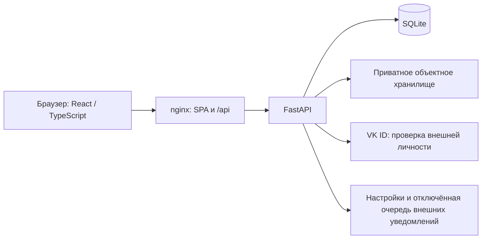

# Profkom Web: архитектура, требования и образ результата

Актуализировано 31 октября 2026 года по локальному коду и согласованным решениям.
Документ описывает продукт и его обязательные границы, а не состояние запущенного
сервера. Наличие функции в коде, локальная проверка, выкладка на тест и выпуск
в production — разные факты; у каждого должно быть собственное доказательство.

Навигация: [документация](docs/README.md) · [инструкция пользователю](docs/USER_GUIDE.md)
· [технические контракты](backend/docs/README.md) · [история решений](docs/decisions/2026-10-30-portal.md).

## 1. Для кого и какой результат нужен

Сайт — единое рабочее пространство Профкома ВМК. Активист видит свои дела и команды,
руководитель управляет работой в своей области, HR и руководство подводят итоги.
Базовая рабочая роль в мероприятии — **организатор**; участник мероприятия означает
его посетителя. Названия «мероприятие» и «подмероприятие» сохраняются.

Ожидаемый результат для пользователя:

- Начать день с календаря и коротких списков ближайших и просроченных задач.
- Найти блок, человека, мероприятие, материал или очередь через поиск и фильтры.
- Выполнять совместную задачу: общий статус, чеклисты, комментарии, файлы и призывы.
- Руководителю — учитывать работу и исправлять оценки из самой задачи, а не искать
  отдельную устаревшую форму. Рабочее состояние задачи и ККР остаются независимыми.
- Получать понятные уведомления и видеть, кто и когда изменил данные.
- Отправить ошибку через жучка и продолжить обсуждение в своём тикете поддержки.

Интерфейс должен быть компактным, единообразным и удобным на desktop и mobile.
Создание начинается по явной кнопке и выглядит как незаполненная страница объекта;
чтение существующего объекта не включает редактирование автоматически.

## 2. Архитектура приложения

Внешние связи на схеме описывают архитектуру. Локальные проверки используют
одноразовую SQLite, синтетические аккаунты и подмены VK/хранилища.

| Слой | Ответственность и исходники |
| --- | --- |
| Frontend | React 19, TypeScript, Vite; маршруты и экраны в `frontend/src`, маршрутизатор и lazy-модули, TanStack Query, Formik/Zod, CSS Modules и общие токены |
| HTTP-контракт | `/api` в [main.py](backend/main.py), доменные маршруты, Pydantic; frontend DTO в [contract.ts](frontend/src/utils/api/contract.ts), клиенты `*.api.ts`; OpenAPI на `/openapi.json` |
| Права | [access.py](backend/access.py): центральная политика и отношения; доменные проверки уточняют доступ к очереди, задаче, файлу и закрытым данным; UI получает `capabilities` |
| Домен и данные | [database.py](backend/database.py), [domain_models.py](backend/domain_models.py), внутренние dataclass в [models.py](backend/models.py); доменные сервисы используют одну общую базу |
| Транзакции | `Database.async_atomic` для HTTP, `Database.atomic` для синхронных сервисов; ревизии и ограничения SQLite; ошибка одного элемента откатывает команду целиком |
| Файлы | [file_access.py](backend/file_access.py): контекст загрузки, проверка байтов, завершённый неизменяемый объект, актуальный ACL; доставка через защищённый same-origin URL |
| Локальная среда | Канонический checkout `profkom_web`; окружения, сборки и доказательства в игнорируемой `.local/`, без второй основной копии репозитория |

Схема расширяется идемпотентными startup-миграциями; Alembic сейчас не применяется.
Изменение модели проходит весь путь: БД → доменная модель → Pydantic → TypeScript
→ API-клиент → query cache → интерфейс и проверки. Ревизии публичной задачи,
приватного оценивания и сводной нельзя подменять друг другом.

## 3. Модель предметной области

- **Аккаунт и сессия:** регистрационное согласование, состояние аккаунта,
  явные роли, отзыв сессий. Членство, руководящая роль и допуск к задаче — разные связи.
- **Блок:** стабильный UUID, мастер, его заместители, HR-куратор и состав.
  Переименование не создаёт новый блок и не передаёт права однофамильцам.
- **Сезон:** планируемый / открытый / подведение итогов / закрытый. Текущий сезон
  и состояние сезона различаются; работа может относиться к разным незакрытым сезонам.
- **Мероприятие → подмероприятия:** равноправные главорги и ответственные,
  их заместители, организаторы, необязательные даты, отчёты и созвоны.
  HR назначается только подмероприятию. Уровни не переименовываются автоматически.
- **Очередь → задачи:** имя, неизменяемый буквенный ключ, владелец, источник работы
  и допуски. Ключ задачи — `КЛЮЧ-N`, технический UUID и прежние ссылки сохраняются.
- **Задача:** общий рабочий статус, автор, исполнители и наблюдатели, тип,
  приоритет, сроки, описание, файлы, чеклисты, связи и публичная история.
- **Приватный учёт:** личные назначения, часы, оценка, критерии, начисления,
  коэффициенты источников и утверждённые версии сезонной сводной.
- **Материал:** опубликованная версия отдельно от черновика; редакторы,
  вложения, история и корзина. Старые гайды имеют явное соответствие материалам.
- **Профиль:** контакты, аватар, действующие и прошлые роли, ручные достижения;
  настройки внешних уведомлений отдельно от просмотра профиля.
- **ПГАС и поддержка:** документы с периодом; обращения WEBSUPPORT с отдельными
  правами заявителя, сотрудников и приватной диагностикой.

## 4. Обязательные правила доступа

Права проверяет backend при каждом чтении и изменении. Название должности, ФИО,
старые флаги `admin`/`super_user` и прежняя роль не заменяют текущие назначения.
Отказ в доступе должен скрывать также старые данные и превью из frontend cache.

| Кто | Существенные права и ограничения |
| --- | --- |
| Активный одобренный аккаунт | Рабочие общедоступные разделы; состав и анонсы команд не открывают их задачи, созвоны, отчёты или ККР |
| Читатель / исполнитель задачи | Одинаковые базовые публичные права: рабочий статус, любые комментарии, галочки чеклистов, присоединение/наблюдение. Сами по себе эти роли не дают редактирование описания, типа, приоритета или ККР |
| Автор / уполномоченный редактор задачи | Описание, классификация, планирование и управление составом по capabilities и ограничениям сезона. Закрывает и переоткрывает автор; если он недоступен — владелец очереди с аудитом |
| Мастер / зам блока, главорг / зам, ответственный / зам | Управление своей областью; главорг работает и с дочерними подмероприятиями. Роль не становится глобальной |
| HR-куратор блока | ККР своего блока; не согласовывает заявки только на основании назначения HR-куратором |
| Мастер HR / фактический зам HR | Глобальные чтение трекера, публичное редактирование в разрешённых сезонах, ККР, сводная, аналитика и HR-этап заявок. Это не глобальное управление отчётами/мероприятиями |
| Председатель / заместители | Глобальные права по центральной политике; открытие/закрытие сезонов и смена руководства имеют отдельные ограничения. Главное мероприятие закрывают/переоткрывают только они |
| Сотрудник поддержки / заявитель | Явное назначение в поддержку; обычное членство в IT не открывает диагностику. Заявитель читает свой тикет, а не всю WEBSUPPORT |

Особые заслуги и волонтёрскую работу учитывают председатель/замы и главорги/их
замы в своём активном мероприятии. Это отдельное право: доступ к обычному
оцениванию ККР не означает право выдавать особые заслуги.

В свой блок нельзя подать заявку повторно, в том числе мастеру и заместителю.
Заявки согласуются на HR-этапе и этапе блока, с автором решения и серверным сроком
подмены 72 часа. Самостоятельный выход из блока отключён; удаление выполняют
уполномоченные роли, предварительно снимая действующее руководство.

## 5. Трекер и сотрудничество

Рабочие статусы: **Открыта → В работе → Выполнена → Закрыта**. Переходы между
незакрытыми состояниями доступны читателям; переход к/из закрытого ограничен
автором и описанным выше fallback. Смена статуса сама по себе не меняет ККР.
«Взять в работу» атомарно добавляет нажавшего в исполнители и меняет статус;
обычный выбор «В работе» никого не назначает.

Очереди создают руководители/заместители в своей области, председатель/замы —
в любой области или для председской работы. Источник обязателен: блок,
мероприятие, подмероприятие либо `chair`. Создание очередей всеми читателями
и новые очереди без команды — отменённые ранние решения.

Владение недоступного владельца передаётся транзакционно: мастер блока для
блочной очереди → мастер HR → председатель. Для остальных очередей первый шаг
пропускается. Если кандидатов нет, недоступность сохраняется явно; GET не чинит её.

Иерархия страницы: **название очереди > родительская задача > ключ задачи** либо
**название очереди > ключ задачи**. Родитель может быть из другой доступной
очереди того же сезона. Скрытые ссылки и родители маскируются при потере доступа.

Типы: задача, веха, эпик. Приоритеты: низкий, средний, высокий, срочный.
Одна задача входит максимум в один продуктовый эпик и несколько вех; эти связи
не заменяют родителя. Зависимости предупреждают, но не выдают право закрытия.
Абстрактных «Целей» в согласованном объёме нет.

Комментарии используют текущий Markdown-редактор: просмотр по глазу, таблицы,
LaTeX, языки/подсветка кода, меню заголовков и списков, подсказки при наведении.
Справки и постоянной строки горячих клавиш нет. Файлы комментария принадлежат
комментарию, отдельно от инструкции и результата; неуспешное сохранение сохраняет
черновик. Исторические FileRef не предоставляют доступ к удалённым вложениям.

Призыв доступного человека уведомляет его; призыв постороннего требует одобрения
автором задачи **или** владельцем очереди. Допуск открывает одну задачу, а не
очередь, приватное ККР или скрытые связи. Отзыв проверяется также при чтении файлов.

Подробности: [workflow](backend/docs/TRACKER_WORKFLOW.md),
[планирование и связи](backend/docs/TRACKER_STAGE2.md),
[вложения комментариев](backend/docs/COMMENT_ATTACHMENTS.md).

## 6. ККР, итоги и аналитика

После закрытия задачи уполномоченный оценщик заполняет общий диалог: критерии
задачи и строки всех исполнителей, одно атомарное сохранение с ревизиями.
У новых закрытий используется наблюдённое сервером время закрытия; неизвестные
старые даты не восстанавливаются из предположений.

Коэффициенты задаются на сезон, по умолчанию 1; разрешены конечные неотрицательные
значения, включая 0. Свой коэффициент имеют блок, главное мероприятие,
подмероприятие, председская работа и соответствующие особые заслуги.
Коэффициент применяется один раз к исходным значениям, включая отрицательные.
Без дедлайна нет надбавки за срочность и штрафа за просрочку. Формула датированной
работы сохраняется; числовой источник истины — серверный расчёт и его тесты.

Сводная показывает участников, составляющие ККР, итог и текущие/прошлые отметки.
Отметки сохраняются по нажатию, без отдельного «Сохранить» в незакрытом сезоне;
закрытые изменения требуют причины и новой версии. «Кик» — исключение за
недостаточную работу, «Найс» — добровольный уход, а не положительная оценка.

Аналитика различает две проекции: статистика закрытых рабочих задач по источникам
и совместимая недельная динамика приватно принятой работы. Их определения нельзя
смешивать. Неизвестные значения — пропуски, а не нули. Закрытые сезоны читают
утверждённый снимок; новое состояние строк не переписывает старые итоги.

Управляемые эпики очереди KKR контролируют заполнение по источникам. Они открыты
весь сезон, закрываются в конце и сами не создают начислений. Призыв на заполнение
использует обычные призывы без дублирующей рассылки.

Подробности: [аналитика и коэффициенты](backend/docs/SEASON_ANALYTICS.md),
[контракт согласованной итерации](docs/decisions/2026-10-30-portal.md).

## 7. Образ интерфейса по разделам

| Раздел | Ожидаемое представление |
| --- | --- |
| Рабочее пространство | Утверждённый вариант A: компактная шапка, «Сегодня» слева, два коротких списка задач справа; личные команды и доступные согласования ниже |
| Мероприятия | Вариант C: единая компактная лента, поиск/участие/период, фазы и даты; личное участие и ближайшее событие сбоку; подмероприятия выделены рамками |
| Календарь | День/неделя/месяц, МСК, URL-фильтры; день/неделя прокручивают страницу, месяц содержит короткие ссылки; пустая сетка «Сегодня» не исчезает |
| Блоки и контакты | Сворачиваемое дерево с поиском, руководством и HR; компактные чипы людей. В контактах названия блоков — текстовые ссылки, мастерство отмечено выбранной короной F |
| Сезоны и ККР | Участники/отметки, компактная плоская таблица источников, коэффициент полем, графики с подсказкой точки; шаблоны здесь, не в профиле |
| Профиль | Просмотр отдельно от редактирования, иконки наград с подробностями, история ролей; настройки уведомлений на отдельной странице |
| Материалы и ПГАС | Явные создание/карандаш/публикация; ПГАС — плоская таблица с фильтрами года и периода «январь–май / июнь–декабрь» |
| Навигация | Общий интерактивный штамп возврата в раздел, уведомления колокольчиком, глобальный жучок вместо отдельного домашнего виджета |

Чипы строятся композицией: `ChipFace`/`ChipAvatar`, `InteractiveChip`, read-only
`HoverCard`, формы в `AnchoredPopover`; специализации пользователя, блока и ККР
отвечают за доменные права и маршрут. `EntityPicker` использует общую внешность
с поиском и выбором ID, без лишних запросов профилей. Новые экраны используют
существующие токены и компоненты, а не собственную несвязанную тему.

## 8. Сохранность, быстродействие и готовность

Неизменяемые ID, комментарии, файлы, учёт, сессии и утверждённые снимки должны
сохраняться при миграции и поставке. Повторный запуск миграции не меняет результат.
Файлы и диагностика не отдаются по публичному URL хранилища; история не открывает
удалённые байты. Диагностика поддержки очищается через 90 дней, тикет остаётся.

Быстрые чтения используют компактные проекции, пакетный ACL и кеш только внутри
одного запроса. GET не согласовывает роли и не пересчитывает ККР. Lazy-модули,
загрузка каталогов по необходимости, отмена устаревшего поиска и один открытый
редактор отметок ограничивают работу браузера. Улучшение скорости подтверждается
парным замером на одинаковых данных, роли и сценарии; общее обещание скорости
или чужие старые числа не заменяют измерение. См. [backend](backend/docs/READ_PROJECTIONS.md)
и [frontend](frontend/docs/READ_PATHS.md).

Результат считается готовым по своему объёму после проверки контрактов, матрицы
прав, ревизий/отката, миграции старой схемы дважды, пропорциональной регрессии,
HTTP на одноразовой БД и нужных desktop/mobile-сценариев. Числа старых тестов
хранятся в отчётах, а не выступают вечным критерием готовности.

**Реальная внешняя доставка email/Telegram/VK ещё не подключена**: готовы
предпочтения и отключённая инфраструктура событий. Будущая отправка должна
повторно проверять права. Демо с выбором ролей существует только в DEV и не
доказывает серверные права или сохранение в БД. Production не входит автоматически
ни в локальную проверку, ни в успешную поставку на тест.

Все новые внешние операции требуют разрешения владельца на среду и действие.
Рабочие правила: [AGENTS.md](AGENTS.md), [проверки](backend/TESTING.md),
[поставка и откат](DEPLOY.md). Исторические исходные задания и разрешения не
возобновляют уже завершённые действия.
