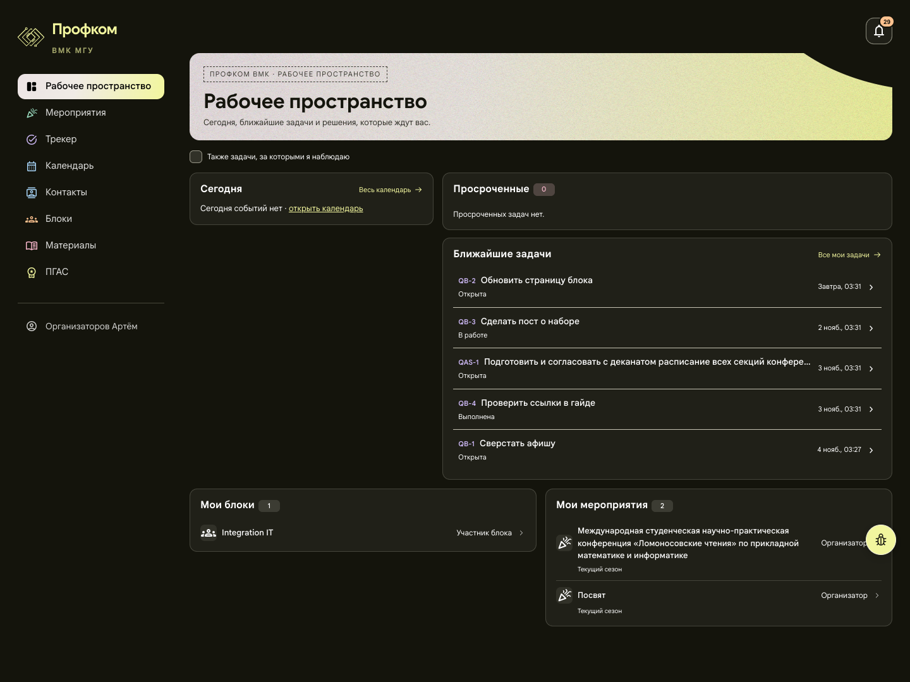
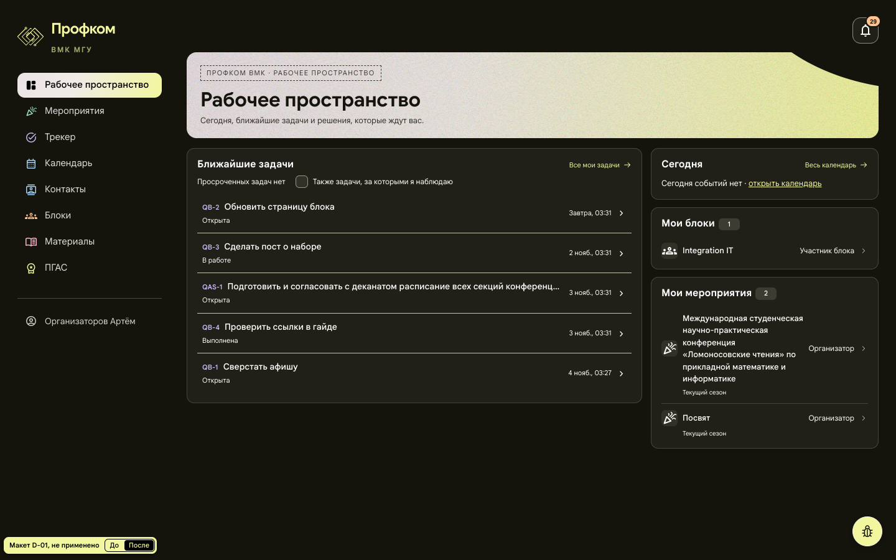
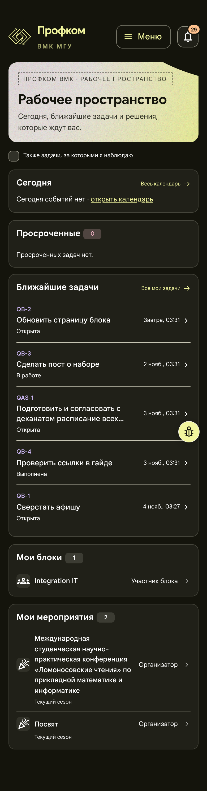
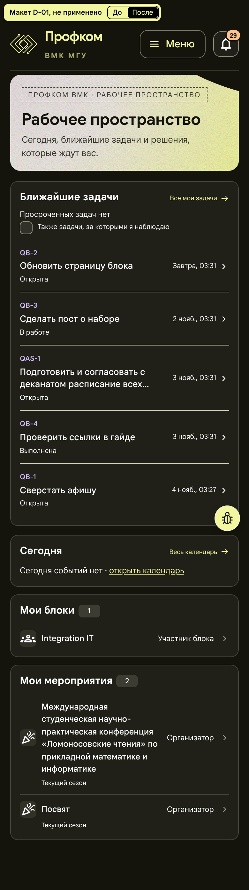

# D-01. Главная: задачи в основной колонке, «Сегодня» и команды сбоку

**Применено 2026-11-01**, см. раздел «Применено (2026-11-01)» в конце. Страница `/` («Рабочее пространство»), все роли. Снимки сделаны под org1 на синтетическом стенде.
Макет: [mockup.html](mockup.html) открывается без сети. Переключатель «До / После» в углу показывает обе раскладки.

## Проблема
- На 1440 сетка делит экран как 1 : 1,8. Слева стоит только «Сегодня» (83 px при пустом дне), и под ним остаётся пустое поле 386 × 417 px. «Мои блоки» и «Мои мероприятия» начинаются только на y = 773.
- Флажок «Также задачи, за которыми я наблюдаю» занимает отдельную строку над карточками.
- На телефоне перед задачами стоят две карточки без содержания («Сегодня событий нет», «Просроченные 0»). Первая задача начинается на y = 560.

## Предложение
- От 1100 px страница делится на основную колонку и боковую (2fr / 1fr).
  - Слева: «Просроченные» (только если их больше нуля) и «Ближайшие задачи».
  - Справа столбиком: «Сегодня», «Требует решения», «Мои блоки», «Мои мероприятия». У org1 нет решений, поэтому «Требует решения» в макете не видно.
- Если просроченных задач нет, вместо карточки под заголовком «Ближайших задач» стоит строка «Просроченных задач нет». Флажок наблюдения переезжает в ту же строку.
- Порядок на телефоне: просроченные (если есть) → ближайшие задачи → сегодня → требует решения → мои блоки → мои мероприятия.
- Карточки, цвета, значки и шрифты не меняются. Меняются только сетка и порядок.

## Польза (замерено на макете)
| | До | После |
|---|---|---|
| 1440: верх «Мои блоки» | y 773 | y 333 |
| 1440: первая задача | y 422 | y 311 |
| 1440: низ содержимого | y 990 | y 721, страница помещается в экран 900 px |
| 390: первая задача | y 560 | y 375, на 185 px выше |
| 390: высота страницы | 1484 | 1391 |

Пустого поля под «Сегодня» больше нет, а задачи стоят первыми.

## Риск и трудоёмкость
- Пользователи привыкли к нынешнему расположению.
- Боковая колонка шириной 366 px (сейчас «Сегодня» занимает 386 px). В занятый день сетка часов станет чуть уже. Длинные названия мероприятий переносятся сильнее: карточка «Мои мероприятия» 276 px вместо 217.
- Тест главной `event-workspace.test.tsx` проверяет флажок, его нужно поправить.
- Трудоёмкость S–M, около 0,5 дня: разметка `DashboardPage` и CSS-сетка. API не меняется.

## Файлы, если одобрить
- `frontend/src/pages/Workspace/WorkspacePages.tsx` (`DashboardPage`)
- `frontend/src/pages/Workspace/Dashboard.module.css`
- `frontend/src/pages/Workspace/event-workspace.test.tsx`

## Изображения
| | До | После |
|---|---|---|
| 1440 |  |  |
| 390 |  |  |

«До» — живые снимки стенда из обзора. «После» — снимки `mockup.html` (390 px сняты при DPR 2).

## Применено (2026-11-01)
Владелец одобрил предложение 2026-11-01. Коммит `c5a9131` ветки `audit/design-home`: `WorkspacePages.tsx` (`DashboardPage`), `Dashboard.module.css`, тесты `dashboard-compact.test.tsx` и `event-workspace.test.tsx` (в нём изменён только тест главной).

**Как в макете.** Сетка 2fr / 1fr от 1100 px, ниже одна колонка. Слева «Просроченные» (только если их больше нуля) и «Ближайшие задачи». Справа «Сегодня», «Требует решения», «Мои блоки», «Мои мероприятия». Строка «Просроченных задач нет» и флажок наблюдения стоят под заголовком ближайших задач. Сборка проверена на локальном стенде с синтетическими данными под org2: у неё, как у org1 в день снимка, нет просроченных задач и событий сегодня. Положение карточек совпало с макетом до пикселя:

| | Макет «После» | Сайт |
|---|---|---|
| 1440: первая задача | y 311 | y 311 |
| 1440: «Сегодня» | x 1046, y 238, 366 × 83 | x 1046, y 238, 366 × 83 |
| 1440: верх «Мои блоки» / «Мои мероприятия» | y 333 / y 445 | y 333 / y 445 |
| 1440: низ содержимого | y 721, страница 900 | y 721, страница 900 |
| 390: «Ближайшие задачи» / первая задача | y 283 / y 375 | y 283 / y 375 |

Горизонтальной прокрутки и обрезанного текста нет на 360, 390, 768, 1024, 1280, 1440 и 1920 px (org1, org2, chair, user05, hrmaster, outsider, junior). Все ссылки карточек, флажок и переход по Tab (сначала задачи, потом боковая колонка) проверены в браузере.

**Чего нет в макете и как сделано.**
- Есть просроченные задачи: карточка «Просроченные» осталась прежней (счётчик, «Все просроченные задачи», список) и стоит над «Ближайшими задачами». Строки «нет просроченных» тогда нет, под заголовком ближайших остаётся только флажок.
- Флажок всегда стоит в карточке «Ближайшие задачи», хотя отбирает задачи для обоих списков. Так у него одно место, и он не перескакивает в другую карточку, когда появляются просроченные. Подпись прежняя.
- Загрузка и ошибка. Рамка карточки «Ближайшие задачи» (заголовок, ссылка, флажок) видна всегда. «Загружаем данные…» или ошибка с кнопкой «Обновить данные» стоят внутри карточки под флажком. Если день с наблюдаемыми задачами не загрузился, флажок можно снять. «Сегодня» и «Требует решения» показываются только с данными, как и раньше: при ошибке их не было.
- Переключение флажка. Пока загружается другой выбор, на экране остаются прежние списки (`aria-busy` у области задач). Флажок не исчезает и не теряет фокус клавиатуры. Раньше обе карточки на это время заменялись строкой «Загружаем данные…».
- Строка «Просроченных задач нет» без точки, как в макете: это строка рядом с флажком, а не отдельный абзац.
- Боковая колонка — область «Сегодня, решения и команды», как в макете. Она заменила прежнюю область «Работа и команды».
- От 768 до 1100 px «Мои блоки» и «Мои мероприятия» стоят друг под другом во всю ширину, как в макете: его правило действует на всех ширинах. Раньше они стояли в две колонки.

**Риски из README.**
- Привычка к прежнему месту карточек: в коде ничего не нужно.
- Узкая боковая колонка. Занятый день проверен на 1280 px (колонка 313 px) и 1440 px (366 px): часы и заголовок дня помещаются, прокрутки вбок нет. Длинные названия мероприятий переносятся, ничего не обрезано.
- Тест главной поправлен. Новые тесты проверяют карточку просроченных, порядок на странице и правила сетки, фокус флажка при загрузке и снятие флажка после ошибки.

**Правки владельца от 2026-11-01.**
- Кнопка «жучка». На сайте она закреплена в правом нижнем углу экрана (`position: fixed`): 22 px от краёв, на ширине до 768 px 40 px и 14 px от краёв. Так на всех ширинах от 360 до 1920 px, вверху и внизу страницы. Ни один предок не ломает закрепление. В конце страницы под кнопкой ничего нет. До 960 px она уходит вниз, пока страницу листают вниз, и возвращается при прокрутке вверх (GL-20). В середине снимка `after-mobile.png` она стоит потому, что это снимок всей страницы: закреплённая кнопка рисуется там, где была на первом экране. Новые снимки сняты по размеру экрана. На первом экране, пока страницу не листали, кнопка может закрывать правый край строки у нижнего края экрана (на 1024 px — стрелку «Весь календарь»). Так у любой плавающей кнопки, D-01 этого не меняет.
- Ширина чипов статуса (D-02). На главной статус задачи — подпись под названием, а не чип, выравнивать здесь нечего.

**Не менялось, замечено при проверке.**
- Короткий срок на главной идёт без года и для следующего года: «19 янв., 03:27» при сегодняшнем 1 ноября 2026. Полная дата есть в подсказке. Это прежняя `deadlineHint` (`workdayDates.ts`), к раскладке D-01 она не относится.
- На ширине до 480 px «Просрочено: 8 ч» переносится на две строки. Ширина срока там ограничена 85 px, так было и раньше.
- Абзац о главной в инструкции пользователя устарел («сетка „Сегодня“ остаётся видимой… Рядом два компактных списка»). Он не правился: в основной рабочей копии владельца инструкция переезжает в `docs/USER_GUIDE.md` (не закоммичено), и правка `docs/USER_GUIDE_20261028.md` столкнулась бы с этим переездом. Предлагаемый текст: «На главной слева задачи: „Просроченные“ (если они есть) и „Ближайшие задачи“. Если просроченных нет, под заголовком ближайших написано „Просроченных задач нет“, рядом флажок „Также задачи, за которыми я наблюдаю“. Справа „Сегодня“, „Требует решения“, „Мои блоки“ и „Мои мероприятия“, на телефоне они идут после задач. Вся строка открывает задачу, полный срок виден при наведении на дату.»

Снимки по размеру экрана (сайт и макет на 1440 и 390 px, другие ширины) лежат в локальной папке аудита `agents/design-home/shots`.
