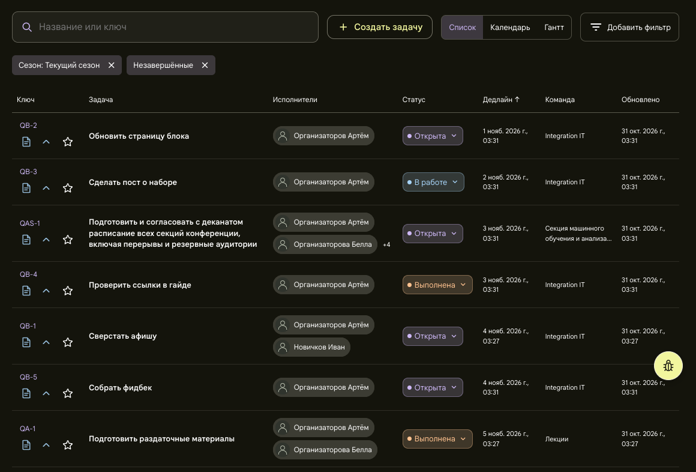
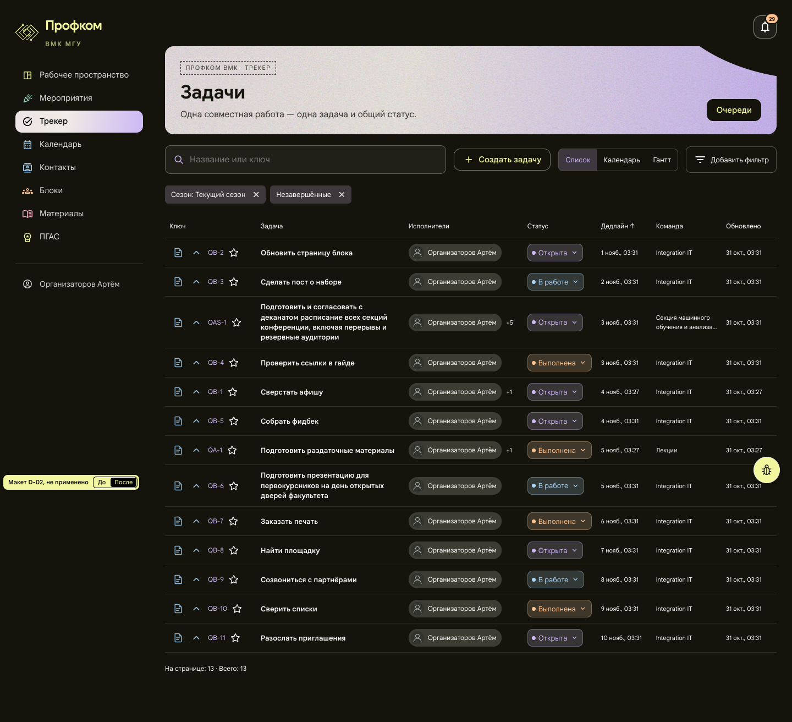
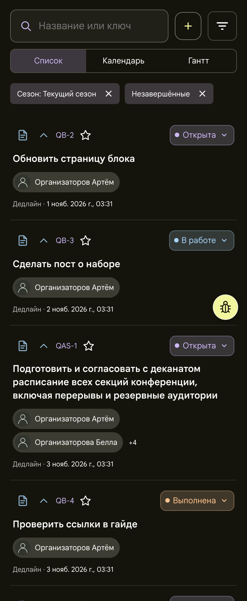
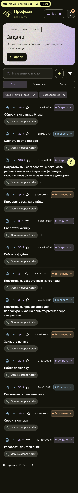

# D-02. Трекер: строка задачи в одну линию

**Применено 2026-11-01** с правкой владельца, см. раздел «Применено» в конце. Страница `/tasks` (таблица списка), все роли. Снимки сделаны под org1: текущий сезон, незавершённые задачи, 13 штук.
Макет: [mockup.html](mockup.html) открывается без сети. Переключатель «До / После» в углу показывает обе раскладки.

## Проблема
- В ячейке «Ключ» ключ стоит над тремя значками (тип, приоритет, избранное).
- «Дедлайн» и «Обновлено» переносятся на две строки: «1 нояб. 2026 г.,» / «03:31».
- Второй исполнитель стоит отдельной строкой.
- В итоге строка занимает 77–94 px даже при коротком названии. На телефоне карточка 170 px.

## Предложение
- Ключевая ячейка в одну строку, как уже сделано на телефоне: [тип][приоритет] QB-2 [★].
- Даты в одну строку и коротко: «1 нояб., 03:31». Год показывается, только если он не текущий. Полная дата остаётся во всплывающей подсказке.
- Исполнители: первый чип и «+N» в одну строку. Остальные имена в подсказке и в тексте для экранного диктора.
- Колонки «Команда» и «Обновлено» остаются.
- На телефоне дедлайн стоит в строке ключа рядом со статусом, исполнители — одной строкой с «+N».

## Польза (замерено на макете)
| | До | После |
|---|---|---|
| 1440: обычная строка | 77 px | 53 px |
| 1440: средняя строка (13 задач) | 81 px | 58 px |
| 1440: высота таблицы | 1098 px | 796 px (−302) |
| 1440×900: строк целиком на первом экране | 5 | 7 |
| 390: обычная карточка | 170 px | 136 px |
| 390: высота списка | 2329 px | 1844 px (−485) |

Строки с длинным названием почти не уменьшаются (94 → 94 и 80 → 76 px), потому что их высоту задаёт название.

## Риск и трудоёмкость
- Без года даты на рубеже декабря и января можно перепутать. Это смягчают подсказка с полной датой и показ года для другого года.
- Колонка «Задача» становится уже: 307 → 269 px. Ключу нужна колонка 150 px, иначе длинные ключи (QAS-12) переносятся.
- На телефоне у даты в строке ключа нет подписи «Дедлайн ·» (она есть сейчас), полная подпись остаётся в подсказке.
- На телефоне всплывающих подсказок нет: в списке виден только первый исполнитель и «+N», остальные видны на странице задачи. Ссылка на профиль второго исполнителя из списка пропадает (сейчас так уже с третьего).
- Нужно сохранить ширину меню статуса (TR-12) и сортировку.
- Тест `tracker-list.test.tsx` («folds assignees after the second into one counter») ждёт два чипа и «+3», его нужно поправить. В обзоре по ошибке указан `tracker-detail.test.tsx`.
- Трудоёмкость S, около 0,5 дня: CSS-модуль, короткий формат даты и хвост исполнителей.

## Файлы, если одобрить
- `frontend/src/pages/Workspace/TrackerList.tsx` (ячейки дат, хвост исполнителей)
- `frontend/src/pages/Workspace/TrackerList.module.css`
- `frontend/src/utils/dates.ts` (короткий формат рядом с `displayDate`)
- `frontend/src/pages/Workspace/tracker-list.test.tsx`

## Изображения
| | До | После |
|---|---|---|
| 1440 |  |  |
| 390 |  |  |

«До» — кадры списка из живых снимков обзора (первые 7 строк на 1440 и 4 карточки на 390). «После» — вся страница `mockup.html` (390 px сняты при DPR 2). Полная страница «До» видна в макете через переключатель.

## Применено (2026-11-01)
Ветка `audit/design-tasks`, коммиты:
- `4eff724`: чипы статуса одной ширины (правка владельца 1);
- `5d48709`: строка задачи в одну линию (D-02).

На 1440, 1280, 1100 и 1024 px живая страница совпадает с видом «После» до пикселя: те же ширины колонок (на 1440: 166 / 269 / 216 / 134 / 100 / 127 / 100 px), строка 53 px, таблица 796 px. На 390 px высота списка тоже как в макете, 1844 px. Отличается только то, что перечислено ниже.

**Правка владельца 1: чипы статуса одной ширины.** Все чипы статуса задачи («Открыта», «В работе», «Выполнена», «Закрыта») шириной с самый длинный, «Выполнена»: 117 px, название по центру. Высота и отступы прежние. Ширину задаёт скрытая строка-образец со всеми названиями, а не число в CSS, поэтому она следует за шрифтом. Других статусов чип не показывает. «На проверке» и прочие статусы назначений есть только в тексте истории. Чип один и тот же везде: строки списка `/tasks` (и с фильтром по блоку, подмероприятию и мероприятию, и в поиске), страницы очередей (в том числе WEBSUPPORT, то есть тикеты поддержки), параметры на странице задачи, телефонная раскладка. Статус как текст (главная, связанные задачи, подсказки календаря и Ганта, история) не менялся. В «Оставшейся работе» и в уведомлениях чипа статуса нет: столбец «Учёт ККР» там — отдельный чип учёта.
- Закрытый для изменения чип («Закрыта» у не-автора, эпики ККР) той же ширины: место стрелки остаётся пустым, точка и название стоят там же, где у соседних чипов. Его название было 16 px вместо 13 px, а сам чип 36 px в высоту вместо 32 px: правило для стрелки задевало подпись. Исправлено.
- Меню статуса прежнее (ширина 240 px, у правого края открывается влево, TR-12). Проверено мышью, касанием и клавиатурой на 1440, 1024, 390 и 360: Enter открывает меню, стрелки двигают выбор, Escape закрывает и возвращает фокус. Рамка фокуса 2 px на месте. После смены статуса ширина чипа та же.

**Отступления от макета и почему.**
1. **Телефон уже 480 px: дедлайн в конце строки исполнителей, а не в строке ключа.** С чипом 117 px строка ключа не вмещает дату. На 390 px нужно 359 px при 350 px доступных: ключ 148, дата 74, чип 117, отступы 20. Дата переносилась на две строки, на 360 px ключ уходил под значки. Высота карточки та же, 136 px. С 480 px дедлайн стоит в строке ключа, как в макете.
2. **Пустой дедлайн: «Без дедлайна» вместо «Не задан».** На телефоне у даты больше нет подписи «Дедлайн ·», и «Не задан» рядом с чипом был бы непонятен. Формулировка та же, что в «Оставшейся работе».
3. **Подсказка у даты называет её:** «Дедлайн: 1 нояб. 2026 г., 03:31», «Обновлено: …». В макете только дата. На телефоне перед датой есть скрытое слово «Дедлайн:» для экранного диктора.
4. **Дата другого года показывается с годом, как раньше** («19 янв. 2027 г., 03:27»), и переносится после запятой на две строки. В макете таких дат нет. Год считается по Москве, рубеж года покрыт тестом.
5. **Длинный ключ** (`WEBSUPPORT-12`, ключ очереди до 32 букв) не помещается рядом со значками в колонке 150 px. Тогда ключ вместе со звездой переходит под значки целиком и не рвётся посередине.
6. **Меню статуса на телефоне теперь над кнопкой «жучка»** (z-index 45, как у листа фильтров). Раньше кнопка закрывала правый край последнего пункта. Найдено при проверке правки владельца 2.

**Риски из этого README.**
- Даты без года: год показывается, если он не текущий; полная дата и её название в подсказке.
- Колонка «Задача» уже: как в макете. На 1024 px она 127 px вместо 169, строка с самым длинным названием растёт 153 → 203 px, но вся таблица короче на 146 px.
- Подпись «Дедлайн ·» на телефоне: см. отступления 1–3.
- Исполнители: видны первый и «+N». Остальные имена в подсказке и в тексте для диктора. Нажатие на «+N» открывает задачу, где видны все исполнители. Длинное имя первого обрезается многоточием, «+N» остаётся виден.
- Ширина меню статуса и сортировка не тронуты.
- Тест `tracker-list.test.tsx` поправлен: один чип и «+4». Добавлены тесты коротких дат, рубежа года, ключевой ячейки, телефонной раскладки и чипа статуса (`dates.test.ts`, `task-status-chip.test.tsx`).

Проверено в браузере на 360, 390, 480, 768, 1024, 1280, 1440 и 1920 px: горизонтальной прокрутки нет, обрезанных названий статуса нет, ключ не рвётся, короткие даты в одну строку. Кнопка «жучка» стоит в правом нижнем углу окна. Когда страница прокручена до конца, под ней нет ни строк, ни кнопок «Назад»/«Далее».
