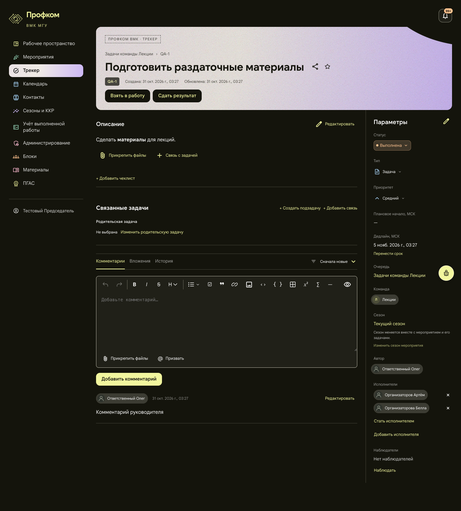
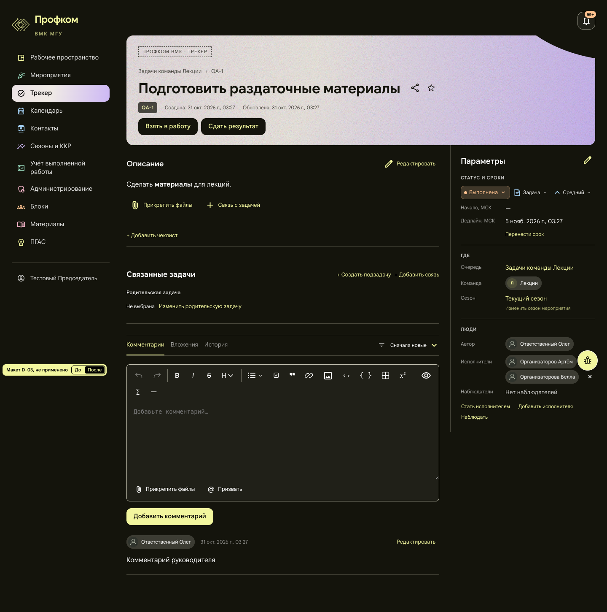
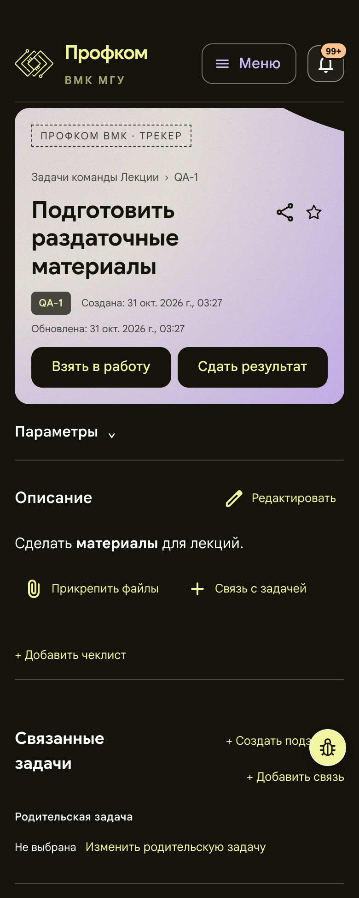
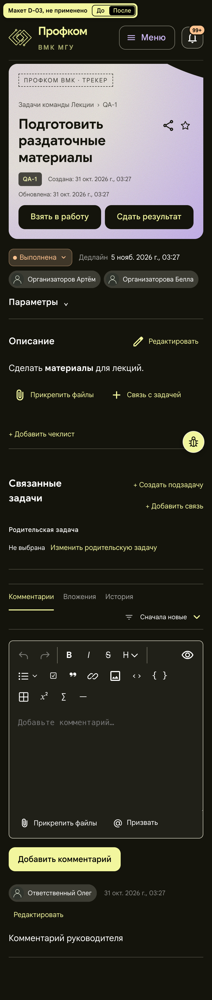

# D-03. Задача: компактная панель «Параметры» и сводка на телефоне

**Не применено.** Страница `/tasks/:id`, все роли. Снимки сделаны под chair: задача QA-1 подмероприятия «Лекции».
Макет: [mockup.html](mockup.html) открывается без сети. Переключатель «До / После» в углу показывает обе раскладки.

## Проблема
- На 1440 «Параметры» — это 11 полей столбиком, всего 1120 px. Панель длиннее описания и комментариев вместе.
- Поле «Сезон» добавляет абзац пояснения.
- Статус, сроки, место и люди идут подряд, без групп.
- На телефоне панель свёрнута целиком: статус, дедлайн и исполнители не видны, пока не раскроешь «Параметры».

## Предложение
Три группы с мелкими подзаголовками и сеткой «подпись слева — значение справа»:
1. **Статус и сроки**: статус, тип и приоритет одной строкой чипов; ниже «Начало, МСК» и «Дедлайн, МСК» с «Перенести срок».
2. **Где**: очередь, команда, сезон. Пояснение о сезоне («Сезон меняется вместе с мероприятием…») уходит в подсказку ссылок.
3. **Люди**: автор, исполнители, наблюдатели. «Стать исполнителем», «Добавить исполнителя» и «Наблюдать» стоят строкой текстовых ссылок под группой.

На телефоне над описанием всегда видна сводка: чип статуса, дедлайн и исполнители. Остальное остаётся под «Параметрами». Когда панель раскрыта, сводка скрывается.

## Польза (замерено на макете)
| | До | После |
|---|---|---|
| 1440: высота панели «Параметры» | 1120 px | 633 px |
| 1440: высота страницы | 1598 px | 1450 px |
| 390: статус, дедлайн, исполнители | только после раскрытия | видны сразу (сводка 86 px) |
| 390: раскрытая панель | 731 px | 607 px |

## Риск и трудоёмкость
- Чтобы подписи и чипы поместились, колонку параметров пришлось расширить с 270 до 344 px. Основная колонка сужается с 842 до 768 px. Из-за этого на 1440 панель инструментов редактора комментариев переносит два последних значка на вторую строку (+38 px). Без расширения длинные чипы людей не помещаются рядом с подписью.
- Три ссылки действий на 1440 не помещаются в одну строку, и «Наблюдать» переносится.
- Описание на телефоне начинается на 86 px ниже (y 520 → 606) из-за сводки.
- На телефоне всплывающих подсказок нет, поэтому пояснение о сезоне там не видно. Его стоит повторить в диалоге изменения сезона.
- В узкой колонке подписей нужны короткие метки: «Начало, МСК» вместо «Плановое начало, МСК».
- Тест `tracker-detail.test.tsx` ищет поля и кнопки по подписям, его нужно поправить.
- Трудоёмкость M, около 1 дня.

## Файлы, если одобрить
- `frontend/src/pages/Workspace/TrackerTaskDetail.tsx`
- `frontend/src/pages/Workspace/TrackerTaskDetail.module.css`
- `frontend/src/pages/Workspace/TaskSeasonParameter.tsx`
- `frontend/src/pages/Workspace/TaskDeadlineParameter.tsx`
- `frontend/src/pages/Workspace/tracker-detail.test.tsx`

## Изображения
| | До | После |
|---|---|---|
| 1440 |  |  |
| 390 |  |  |

«До» — живые снимки из обзора (на 390 — верх страницы до комментариев). «После» — снимки `mockup.html` (390 px сняты при DPR 2, «Параметры» свёрнуты, как в приложении).
