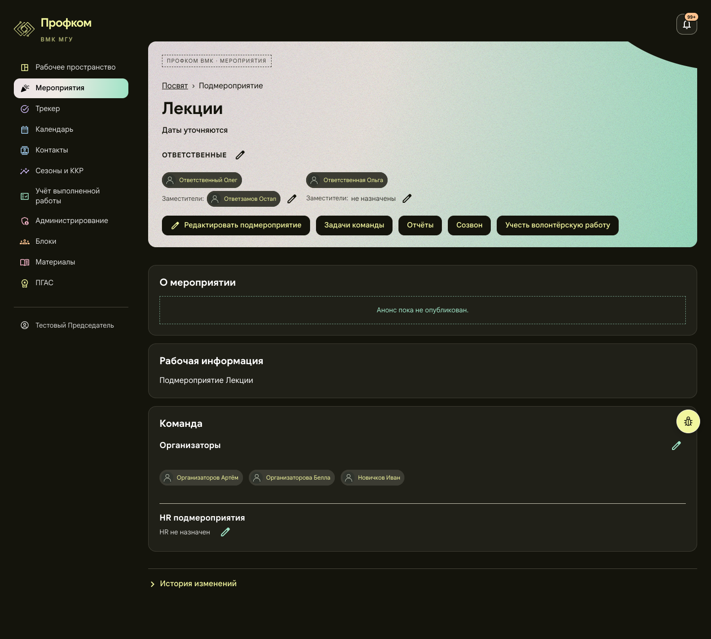
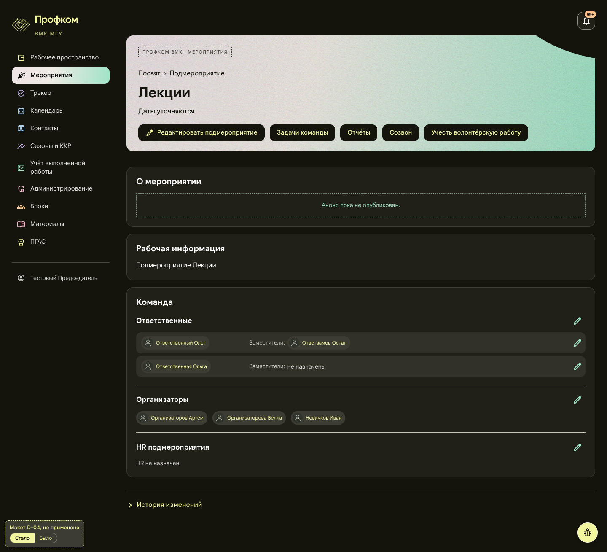
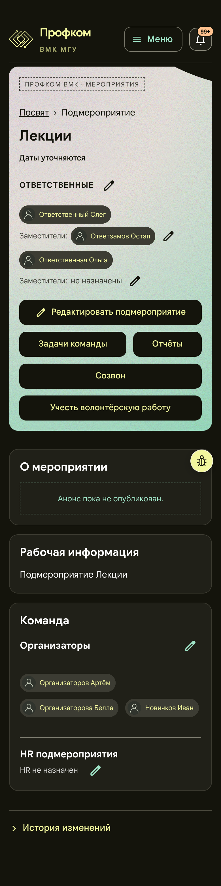
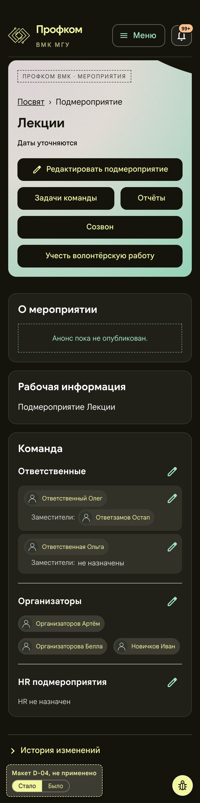

# D-04. Подмероприятие: руководство в карточке «Команда»

Статус: **применено 2026-11-01**, см. «Применено (2026-11-01)» в конце. Ниже описание макета, каким его одобрили. Страницы: `/subevents/:id` и `/events/:id`. Снимки сделаны под председателем, подмероприятие «Лекции».

Макет: [mockup.html](mockup.html). Он собран из снимка живой страницы (сам снимок в папку не включён: «Было» в макете показывает его целиком), изменена только раскладка. В левом нижнем углу есть метка «Макет D-04, не применено» и переключатель «Стало / Было».

## Проблема
Ответственные, их заместители и карандаши стоят в цветной шапке. Организаторы и HR стоят в карточке «Команда» ниже, так что команда разорвана на две части. Шапка занимает 417 px на 1440 и 640 px на телефоне. Строки «Заместители:» идут под каждым руководителем вразбивку. Если прав на правку нет, карандашей тоже нет, и заместитель первого ответственного читается как общий.

## Предложение
- В шапке остаются крошки, название, даты и кнопки действий.
- Карточка «Команда» делится на три раздела: «Ответственные» → «Организаторы» → «HR подмероприятия». Карандаш каждого раздела стоит справа в его заголовке.
- «Ответственные» показаны строками, по строке на руководителя: чип руководителя, справа «Заместители:» с его заместителями (или «не назначены»), карандаш заместителей в конце строки.
- На телефоне руководитель и карандаш стоят в первой строке, а его заместители идут под ним с отступом.
- Цвета, значки, шрифты, чипы и тексты не меняются.

## Польза (замерено на макете)
| | Было | Стало |
|---|---|---|
| Шапка, 1440 | 417 px | 275 px |
| Шапка, 390 | 640 px | 420 px |
| «О мероприятии» начинается, 1440 / 390 | y 537 / 789 | y 395 / 569 |
| «Команда» начинается, 1440 / 390 | y 823 / 1059 | y 681 / 839 |

- Весь состав собран в одном месте, и пара «руководитель → его заместители» видна явно.
- Общая длина страницы почти не меняется (1295 → 1309 px и 1557 → 1558 px): люди не исчезают, а переезжают из шапки в карточку.
- На телефоне шапка выходит выше прежней оценки (~330 px): пять кнопок действий по-прежнему занимают четыре строки.

## Риск и трудозатраты
- Компонент `Leaders` рисует и «Руководство» на странице блока, поэтому новую строку надо либо включать параметром, либо принять вместе с D-05. Макет D-05 использует ту же строку.
- На странице мероприятия карточки «Команда» сейчас нет. «Главорги» уйдут из шапки в отдельную карточку над «Подмероприятиями». В макете это не показано.
- Руководители какое-то время будут искать карандаши в шапке.
- Тест `leaders-deputies.test.tsx` ищет блок `headerLeaders` в шапке, его придётся переписать.
- Трудозатраты: M, около 1 дня. API не меняется.

## Что изменится при одобрении
- `frontend/src/pages/Workspace/EventPages.tsx`: шапки и карточка «Команда» на обеих страницах.
- `frontend/src/pages/Workspace/EventLeaders.tsx`: строка «руководитель | заместители | карандаш».
- `frontend/src/pages/Workspace/EventEditor.module.css`
- `frontend/src/pages/Workspace/event-workspace.test.tsx`
- `frontend/src/pages/Workspace/leaders-deputies.test.tsx`: в списке опроса его не было, но он проверяет `headerLeaders` в шапке мероприятия.

## Было / стало
| | Было | Стало |
|---|---|---|
| 1440 |  |  |
| 390 |  |  |

**Применено, сайт после внедрения (2026-11-01):** [1440](applied-desktop.png) · [390](applied-mobile.png); страница мероприятия «Посвят» с новой карточкой «Команда»: [1440](applied-desktop-event.png) · [390](applied-mobile-event.png). Снимки всей страницы на стенде с синтетическими данными, та же страница и роль, что у «до», сборка `audit/design-integrate`. Плавающая кнопка «жучка» в этих снимках скрыта: снимок всей страницы рисует её там, где кончался первый экран, а на сайте она стоит в правом нижнем углу экрана.

## Применено (2026-11-01)
Владелец одобрил предложение 2026-11-01. Коммит `3b719b2` в ветке `audit/design-team`: «feat(layout): team card for events, block actions in the header (D-04, D-05, owner 2026-11-01)». D-04 и D-05 сделаны вместе: подмероприятие, мероприятие и блок рисуют одну строку «руководитель → заместители» (`Leaders` в `EventLeaders.tsx`).

Как сделано:
- Подмероприятие совпадает с видом «Стало». Под председателем, «Лекции»: шапка 275 px на 1440 и 420 px на 390, страница 1309 и 1558 px, как в макете. Положения карточек, заголовков, строк и карандашей совпадают до пикселя. Снимки страницы и макета в одном браузере отличаются только сглаживанием нескольких глифов.
- Мероприятие (в макете его нет). В шапке остались отметка раздела, название, даты, плашка «Мероприятие закрыто» и кнопки действий справа, как раньше. Главорги переехали в новую карточку «Команда» сразу под карточкой описания, над «Ближайшими подмероприятиями» и «Подмероприятиями». Карточка собрана так же, как у подмероприятия: заголовок «Главорги», справа его карандаш, ниже по строке на главорга с его заместителями и карандашом.
- Названия кнопок для экранного диктора не изменились: «Изменить ответственных», «Изменить главоргов», «Изменить заместителей: имя», «Изменить состав организаторов», «Изменить HR подмероприятия».

Отличия от макета:
- На телефоне у строки заместителей появился отступ 12 px справа. Без него длинный чип заместителя (например, «Константинопольская-Преображенская Александра-Виктория Владиславовна») упирается в правый край строки. С именами из макета разницы не видно.
- В узкой колонке на широком экране (уже 34rem) строка складывается так же, как на телефоне. Так бывает на странице блока между 769 и примерно 1200 px. Без этого заместители получали полоску шириной около 130 px и рвались посреди слова. На 1440 и 390 это правило не действует. В макете такой ширины нет.

Риски, как решены:
- Общий компонент `Leaders`: новая строка включена сразу на всех трёх страницах (D-04 и D-05 одобрены вместе).
- Права. Если прав на правку нет, карандашей нет, а заместители стоят в строке своего руководителя и не читаются как общие. Строка «Заместители:» видна, когда заместители есть или их можно назначить. Проверено на стенде: председатель, head1 и head1dep на мероприятии; председатель, resp1, resp1dep, head1, org1 и outsider на подмероприятии. Набор карандашей совпал с правами, которые даёт API.
- Тесты: переписан `leaders-deputies.test.tsx` (строки и карандаши в карточке, шапка без людей, порядок разделов, читатель без прав). В `event-workspace.test.tsx` изменён только тест про главоргов. Проверки телефонного и узкого варианта лежат в `block-page-layout.test.tsx`.

Проверка: `tsc` и `eslint` без ошибок, все 1091 юнит-тест фронтенда проходят. Сборка открыта на локальном стенде с синтетическими данными на 360, 390, 768, 1024, 1280, 1440 и 1920 px: горизонтальной прокрутки нет, длинные имена переносятся, а не обрезаются. Кнопка «жучка» везде стоит в правом нижнем углу (22 px от краёв, на телефоне 14 px). Когда страница прокручена до конца, под кнопкой ничего нет.
