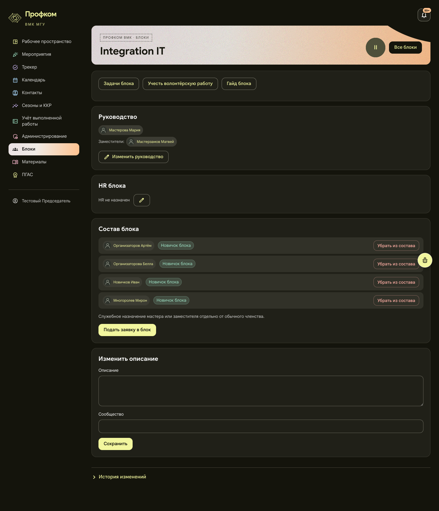
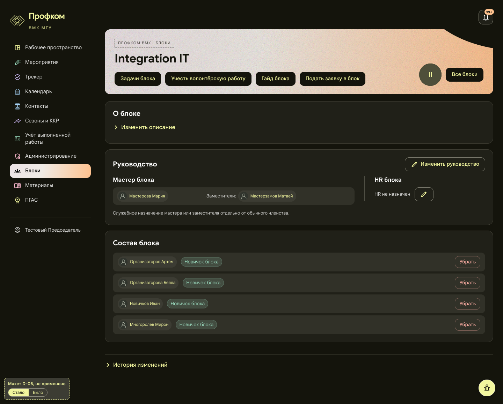
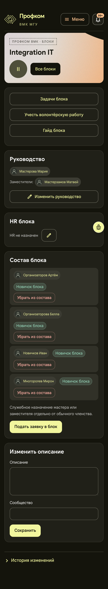
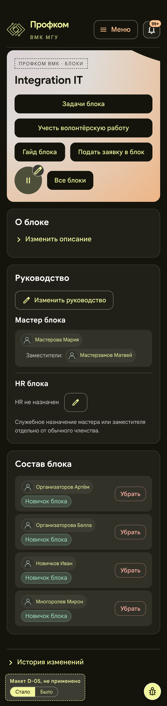

# D-05. Блок: действия в шапке, руководство и HR вместе, описание по кнопке

Статус: **применено 2026-11-01**, см. «Применено (2026-11-01)» в конце. Ниже описание макета, каким его одобрили. Страница: `/blocks/:id`. Снимки сделаны под председателем, блок Integration IT.

Макет: [mockup.html](mockup.html). Он собран из снимка живой страницы (сам снимок в папку не включён: «Было» в макете показывает его целиком), изменена только раскладка. В левом нижнем углу есть метка «Макет D-05, не применено» и переключатель «Стало / Было».

## Проблема
Страница собрана из шести карточек:
- первая карточка содержит только три кнопки (100 px, на телефоне 208 px);
- «Руководство» и «HR блока» разнесены по разным карточкам;
- у председателя внизу всегда раскрыта пустая форма «Изменить описание» (358 px);
- пояснение о служебном назначении и кнопка «Подать заявку в блок» стоят внутри «Состава»;
- на телефоне участник занимает три строки (94–133 px), и состав из четырёх человек занимает 667 px.

## Предложение
1. «Задачи блока», «Учесть волонтёрскую работу», «Гайд блока» и «Подать заявку в блок» встают рядом в шапку, под название, как на подмероприятии. Аватар и «Все блоки» остаются справа.
2. Карточка «О блоке» с описанием. Форма описания и сообщества раскрывается по «Изменить описание» на месте.
3. Одна карточка «Руководство»:
   - слева «Мастер блока»: мастер → заместители, та же строка, что в D-04;
   - справа колонка «HR блока» со своим карандашом;
   - «Изменить руководство» стоит в шапке карточки, пояснение о служебном назначении — мелкой подписью под ней.
4. «Состав блока»: чип · бейдж · «Убрать». Полный текст «Убрать из состава: имя» уходит в подпись кнопки и в `aria-label`, диалог подтверждения прежний.

Цвета, значки, шрифты и чипы не меняются.

## Польза (замерено на макете)
| | Было | Стало |
|---|---|---|
| Вся страница, 1440 | 1677 px | 1158 px |
| Вся страница, 390 | 2100 px | 1644 px |
| Строка участника, 390 | 94–133 px | 83 px |
| «Состав блока», 1440 / 390 | 410 / 667 px | 320 / 428 px |

- Пустая форма больше не выглядит основным содержимым страницы, а руководство и HR читаются вместе.
- На телефоне «чип · бейдж · Убрать» в одну строку не помещается: нужно 336–381 px (чип 129–174, бейдж 118, кнопка 73, промежутки 16), а у строки 292 px. Строка становится двухуровневой: чип, под ним бейдж, кнопка справа. Поэтому страница на 390 выходит 1644 px, а не около 1350, как оценивал опрос.

## Риск и трудозатраты
- Набор кнопок шапки зависит от роли: по данным опроса у junior две кнопки, у председателя до пяти. В макете у председателя четыре кнопки, на телефоне они занимают три строки.
- В шапку переезжают и подписи «Гайд доступен участникам блока» / «Гайд ещё готовится», а также «Заявка: … · Открыть».
- В шапке кнопки получают её готовый тёмный стиль, как на подмероприятии. «Подать заявку в блок» теряет жёлтую заливку главной кнопки, а «Задачи блока», «Учесть волонтёрскую работу» и «Гайд блока» из контурных становятся тёмными. Новых цветов нет.
- Если описания нет и править его нельзя, карточку «О блоке» не показывать: иначе она будет пустой.
- Свёрнутая форма описания должна сохранять черновик. `UnsavedChangesScope` для этого уже есть.
- Короткая кнопка «Убрать» в списке требует точной подписи для экранного диктора.
- Тесты:
  - `role-workspace-followup*` ищут «Подать заявку в блок» и «Изменить HR блока»;
  - `people-links.test.tsx` ищет карточку «Состав блока» и класс `blockHeaderActions` у «Все блоки». В макете оба сохранены.
- Трудозатраты: M, около 1 дня.

## Что изменится при одобрении
- `frontend/src/pages/Workspace/MembershipPages.tsx`
- `frontend/src/pages/Workspace/MembershipPages.module.css`
- `frontend/src/pages/Workspace/BlockHr.tsx`
- `frontend/src/pages/Workspace/role-workspace-followup.test.tsx`
- `frontend/src/pages/Workspace/role-workspace-followup.integration.test.tsx`
- `frontend/src/pages/Workspace/people-links.test.tsx`
- `frontend/src/pages/Workspace/leaders-deputies.test.tsx`: его нет в списке опроса. Он проверяет карточку «Руководство» (нет формы, одно «Заместители», кнопка «Изменить руководство»), его надо прогнать и при необходимости поправить.
- Строка «мастер → заместители» общая с D-04: `EventLeaders.tsx` и `EventEditor.module.css`.

## Было / стало
| | Было | Стало |
|---|---|---|
| 1440 |  |  |
| 390 |  |  |

## Применено (2026-11-01)
Владелец одобрил предложение 2026-11-01. Коммит `3b719b2` в ветке `audit/design-team`: «feat(layout): team card for events, block actions in the header (D-04, D-05, owner 2026-11-01)». Строка «мастер → заместители» общая с D-04.

Как сделано:
- Страница совпадает с видом «Стало». Под председателем, Integration IT: шапка 186 px на 1440 и 354 px на 390, страница 1158 и 1644 px, как в макете. Положения карточек, строк и кнопок совпадают до пикселя.
- Ряд действий под названием блока — новое место `headerNav` у общего `Page`. В нём, если они доступны: «Задачи блока», «Учесть волонтёрскую работу», гайд, «Сообщество блока» и заявка. Гайд — ссылкой или подписью «Гайд доступен участникам блока» / «Гайд ещё готовится». Заявка — кнопкой «Подать заявку в блок» или строкой «Заявка: … · Открыть».
- «Изменить описание» раскрывается на месте внутри карточки «О блоке».
- «Убрать» в составе: доступное имя и подсказка — «Убрать из состава: имя». Для этого у `ActionForm` появился параметр `submitTitle`. Пока команда отправляется, имя снимается, и диктор читает «Сохраняем…». Вопрос «Исключить … из блока?» прежний.

Отличия от макета:
- «Сообщество блока» стоит в ряду шапки после гайда, где и было. У блока из макета сообщества нет.
- Подписи гайда и «Заявка: …» в шапке набраны тёмным цветом шапки (подписи с прозрачностью 0,8, как подписи в шапке подмероприятия). Строка заявки набрана 14 px, как подпись гайда рядом. Иначе светлый серый текст терялся на светлом фоне шапки.
- Если заявка не ушла, сообщение об ошибке встаёт в шапке отдельной строкой. Не помещается в ряд и вопрос перед исключением: на телефоне он занимает всю строку участника. В макете оба состояния не показаны.
- Строка «Чтобы выйти из блока, обратитесь к …» для рядового участника осталась в «Составе блока». У председателя из макета её нет.
- Между 769 и примерно 1200 px строка мастера в узкой левой колонке складывается, как на телефоне. Подробнее в D-04.

Риски, как решены:
- Кнопки шапки по ролям. Проверено на стенде, у каждой роли набор кнопок совпал с правами из API, ни одно действие не потерялось:
  - председатель и зам: задачи, учёт работы, гайд, заявка; описание, руководство, HR и «Убрать» доступны;
  - master: задачи и гайд; описание, руководство и «Убрать»;
  - mdeputy: задачи и гайд; описание и «Убрать»;
  - junior и org1: задачи и гайд; правки нет, есть строка о выходе из блока;
  - outsider: «Гайд доступен участникам блока» и заявка; после отправки в шапке видно «Заявка: На рассмотрении HR · Открыть»;
  - hrmaster и hrdeputy в блоке HR: задачи, гайд и описание; у hrmaster ещё руководство и HR;
  - hrmaster и hrdeputy в блоке IT: задачи, подпись гайда, заявка и «Убрать»; у hrmaster ещё карандаш HR.
- Жёлтая заливка «Подать заявку в блок» в шапке уходит, кнопки получают готовый тёмный стиль шапки, как в макете. Новых цветов нет.
- Пустая «О блоке». Если описания нет и править его нельзя, карточки нет. Тот, кто может править, видит карточку только с «Изменить описание».
- Черновик описания. Свёрнутый `
` не убирает форму со страницы, поэтому черновик сохраняется. При уходе со страницы прежнее окно спрашивает «Есть несохранённые изменения». Проверено в браузере на 1440 и 390.
- Тесты:
  - `people-links.test.tsx` и `role-workspace-followup.test.tsx` проходят без правок: карточка «Состав блока», класс `blockHeaderActions` и кнопки «Подать заявку в блок» и «Изменить HR блока» сохранены;
  - `role-workspace-followup.integration.test.tsx` ищет те же кнопки по тексту и подписи. В этой задаче интеграционные тесты не запускались;
  - в `general-iteration.test.tsx` «Убрать из состава» теперь ищется по подписи для диктора;
  - новый `block-page-layout.test.tsx` проверяет ряд в шапке по ролям, скрытую «О блоке», сохранение черновика, короткое «Убрать», заявку в шапке, а также телефонный и узкий варианты в CSS.

Проверка: `tsc` и `eslint` без ошибок, все 1091 юнит-тест фронтенда проходят. На 360, 390, 768, 1024, 1280, 1440 и 1920 px горизонтальной прокрутки нет. Длинные имена мастера, заместителей и HR переносятся. Кнопка «жучка» везде в правом нижнем углу. Когда страница прокручена до конца, под ней ничего нет.
