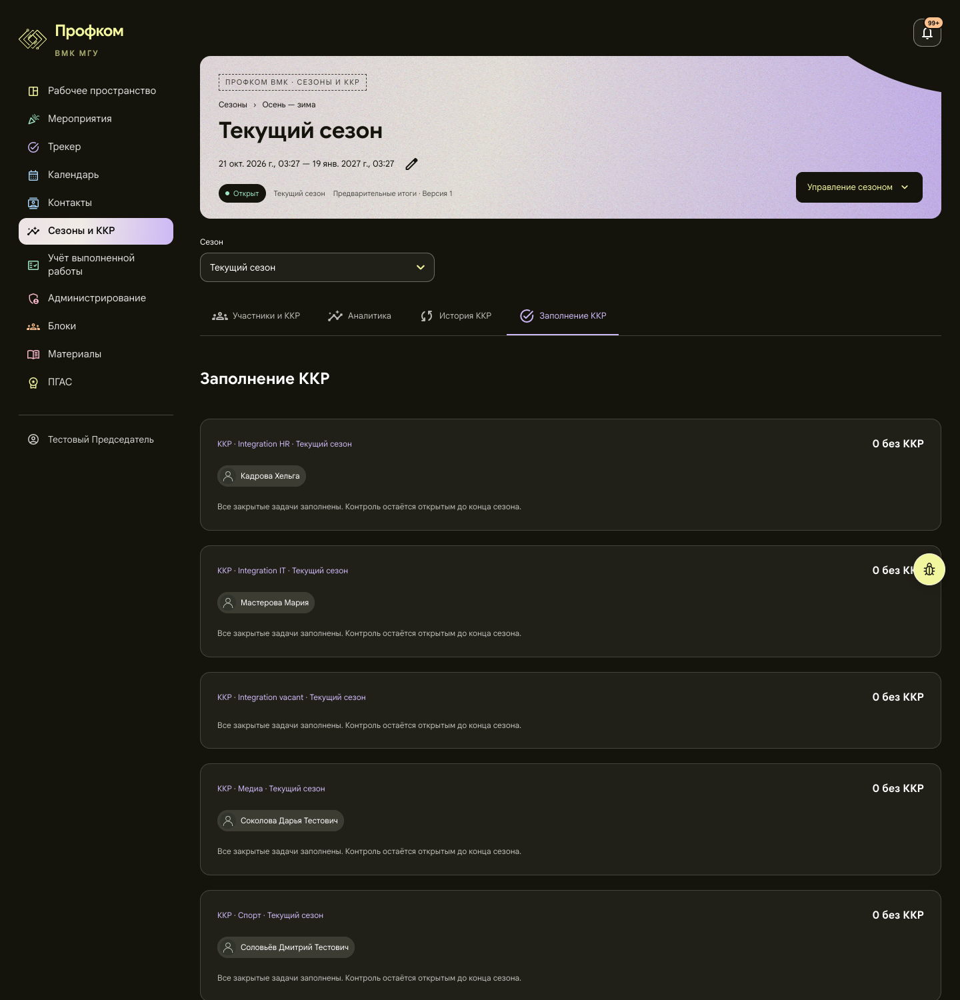
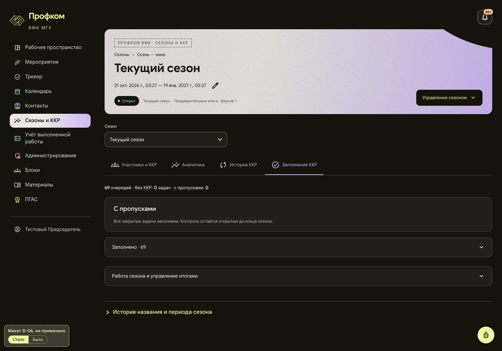
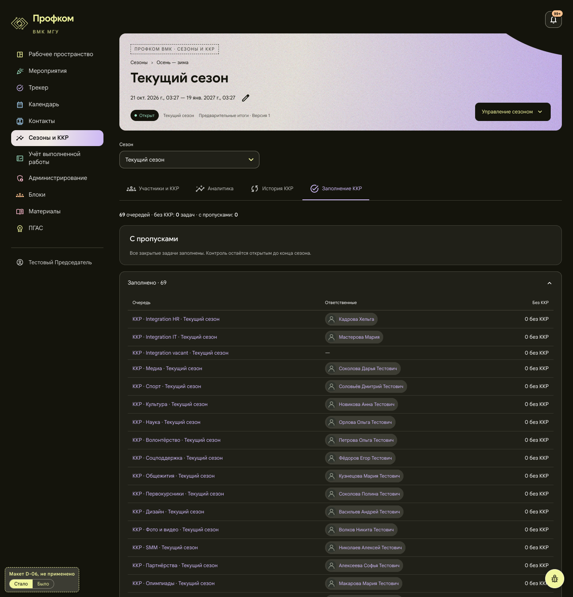
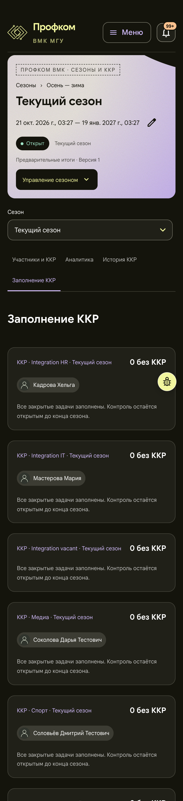
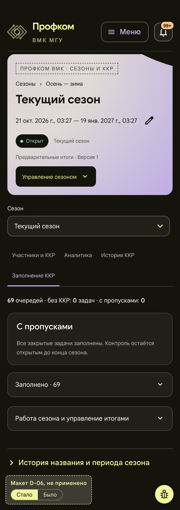
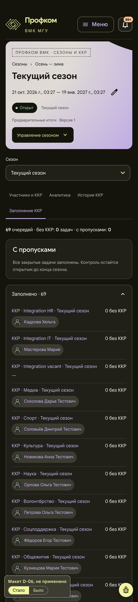

# D-06. Сезон, «Заполнение ККР»: сначала пропуски, заполненные компактным списком

Статус: **применено 2026-11-01**, см. раздел «Применено» в конце. Страница: `/seasons/:id?tab=control`, видят председатель и замы. Снимки сделаны под председателем, текущий сезон.

Макет: [mockup.html](mockup.html). Он собран из снимка живой страницы (сам снимок в папку не включён: «Было» в макете показывает его целиком), изменена только раскладка. В левом нижнем углу есть метка «Макет D-06, не применено» и переключатель «Стало / Было».

## Проблема
- Вкладка выводит 69 одинаковых карточек по 168 px (на телефоне по 176 px).
- В каждой карточке стоит «0 без ККР» и одна и та же фраза «Все закрытые задачи заполнены. Контроль остаётся открытым до конца сезона.».
- Страница занимает 13 920 px на 1440 и 16 275 px на телефоне. Очереди с пропусками, ради которых вкладка существует, пришлось бы искать прокруткой.
- Заголовок «Заполнение ККР» повторяет название активной вкладки.

## Предложение
- Сверху стоит строка-сводка: «69 очередей · без ККР: 0 задач · с пропусками: 0».
- Ниже идёт раздел «С пропусками»: нынешние карточки только для очередей с пропусками, по убыванию их числа.
  - Сейчас пропусков нет, поэтому в разделе один раз стоит прежняя фраза.
- Ниже свёрнутый раздел «Заполнено · 69»: строка таблицы на очередь (название-ссылка, ответственные, «0 без ККР»), без повторяющейся фразы.
  - У двух очередей без ответственных стоит «—».
  - На телефоне строка двухуровневая: название и число, под ними чипы.
- Дублирующий заголовок убран.
- Использованы готовые стили страницы: раскрывающийся блок `disclosure` и таблица `sourcesTable`. Цвета, значки и шрифты не меняются.

## Польза (замерено на макете)
| | Было | Стало (свёрнуто) | Стало (раскрыто) |
|---|---|---|---|
| Страница, 1440 | 13 920 px | 1 009 px | 4 210 px |
| Страница, 390 | 16 275 px | 1 101 px | 7 569 px |

- При полном заполнении страница примерно в 14–15 раз короче. Опрос оценивал около 800 px, замер дал около 1 000–1 100 px.
- Очереди, где нужна работа, всегда стоят наверху.

## Риск и трудозатраты
- Свёрнутый список прячет ответственных у заполненных очередей, они открываются одним нажатием.
- Сортировка по пропускам меняет нынешний порядок.
- Фраза под очередью зависит от статуса контроля («…остаётся открытым…» или «Контроль завершён вместе с сезоном.»). В сводке её надо выводить по статусу, а не один раз на всех.
- Тесты: опрос пишет, что тестов на этот вид нет. На деле `SeasonKkrControl` уже проверяет `season-kkr-views.test.tsx`: фразы открытого и закрытого контроля, ссылку `?kkr=1` на задачу с пропуском, кнопку «Призвать на заполнение». Новые случаи (порядок, свёрнутый список) лучше добавить туда, а не в отдельный файл.
- Трудозатраты: S, около 0,5 дня. Меняются только `SeasonKkrControl` и стили.

## Что изменится при одобрении
- `frontend/src/pages/Workspace/SeasonKkrViews.tsx`
- `frontend/src/pages/Workspace/SeasonWorkspace.module.css`
- `frontend/src/pages/Workspace/season-kkr-views.test.tsx`: дополнить. Опрос предлагал новый файл `season-kkr-control.test.tsx`.

## Было / стало
Снимки «Было» обрезаны опросом до 1500 и 1700 px. Раскрытый список тоже обрезан до этой высоты.

| | Было | Стало | Стало, список раскрыт |
|---|---|---|---|
| 1440 |  |  |  |
| 390 |  |  |  |

**Применено, сайт после внедрения (2026-11-01):** [1440](applied-desktop.png) · [390](applied-mobile.png); «Заполнено» раскрыто: [1440](applied-desktop-open.png) · [390](applied-mobile-open.png). Снимки всей страницы на стенде с синтетическими данными, та же страница и роль, что у «до», сборка `audit/design-integrate`. Плавающая кнопка «жучка» в этих снимках скрыта: снимок всей страницы рисует её там, где кончался первый экран, а на сайте она стоит в правом нижнем углу экрана.

## Применено (2026-11-01)
Ветка `audit/design-seasons`, коммиты:
- `62f8492`: сводка, раздел «С пропусками» и свёрнутый список «Заполнено» (D-06);
- `8103e6b`: строки свёрнутого списка остаются на странице для поиска браузера.

На 1440 и 390 px всё, что стоит под строкой вкладок, совпадает с видом «После» до пикселя. Совпадают сводка (20 px), раздел «С пропусками» (101 и 113 px) и «Заполнено · 69» (55 и 51 px). У раскрытой таблицы на 1440 те же колонки (484 / 424 / 163 px), строки 45 px на 1440 и 79 px на 390. Сама строка вкладок на сайте выше, чем в макете: на 81 px на 1440 и на 93 px на 390. Макет снят до D-07, а D-07 убрал поле «Сезон» под шапкой и уложил вкладки телефона в одну строку.

**Отступления от макета и почему.**
1. **Очереди с пропусками стоят строками одной панели, а не отдельными карточками.** В макете пропусков нет, и «С пропусками» там одна панель с фразой. Карточки внутри панели стали бы карточками в карточке. Поэтому каждая очередь занимает строку панели и отделена линией. В строке то же, что было в карточке:
   - название-ссылка на контрольный эпик, справа «N без ККР»;
   - ответственные;
   - задачи без ККР: ссылка `?kkr=1` и чипы исполнителей.

   Очереди идут по убыванию числа пропусков, при равном числе в порядке сервера. На стенде с синтетическими пропусками проверен порядок 3 / 2 / 1, ссылки `?kkr=1` и «Призвать на заполнение».
2. **Фраза следует статусу контроля** (риск из README):
   - если все контроли открыты, один раз стоит «Все закрытые задачи заполнены. Контроль остаётся открытым до конца сезона.»;
   - если сезон закрыт или закрыты все контроли, один раз стоит «Контроль завершён вместе с сезоном.»;
   - если один контроль закрыт раньше остальных, общая фраза остаётся открытой, а в его строке мелко написано «Контроль завершён вместе с сезоном.».

   Когда пропуски есть, фраза переезжает в начало свёрнутого списка, потому что говорит о заполненных очередях.
3. **«С пропусками» стал заголовком второго уровня, в макете это `h3`.** Заголовок «Заполнение ККР», повторявший вкладку, убран, и `h3` сразу под `h1` страницы пропустил бы уровень. Размер и высота те же.
4. **Раздел назван «Заполнение ККР» для экранного диктора** через `aria-label`, потому что видимого заголовка больше нет.
5. **Строки свёрнутого списка остаются на странице.** Закрытый `details` их только прячет, поэтому поиск браузера находит очередь по названию и раскрывает список, как раньше находил карточку.
6. **Если пропуски у всех очередей, «Заполнено» не выводится:** пустой раскрывающийся блок не нужен. Без контрольных эпиков (планируемый сезон) стоит прежнее «Контрольные эпики ещё не созданы…», без сводки.

**Риски из этого README.**
- Свёрнутый список прячет ответственных. Они открываются одним нажатием или клавишей Enter на «Заполнено · N» (рамка фокуса на месте), а строки находит поиск браузера.
- Порядок меняется. Очереди с пропусками стоят сверху по убыванию, заполненные идут в прежнем порядке сервера.
- Фраза по статусу: см. отступление 2.
- Тесты. Новые случаи добавлены в `season-kkr-views.test.tsx`, отдельного файла нет. Это три теста:
  - порядок и свёрнутая таблица с «—» у очереди без ответственных;
  - фраза по статусу, включая смешанный случай и закрытый сезон;
  - список «Заполнено» пропадает, когда пропуски у всех очередей.

  Прежние проверки файла (фразы, ссылка `?kkr=1`, «Призвать на заполнение») прошли без изменений.

**Проверено в браузере** на локальном стенде с синтетическими данными:
- сезоны в каждом состоянии: планируемый, текущий открытый, на подведении итогов, закрытый;
- роли: председатель, его зам, `hrmaster`, `hrdeputy`. Рядовой участник вкладки не видит, как и раньше;
- ширины 360, 390, 768, 1024, 1280, 1440 и 1920 px.

Горизонтальной прокрутки нет, обрезанного текста нет. На телефоне шапка таблицы скрыта намеренно, как в макете. Кнопка «жучка» стоит в правом нижнем углу окна: 22 px от краёв на широком экране, 14 px на 360–768 px. Когда страница прокручена до конца, под кнопкой ничего нет.
