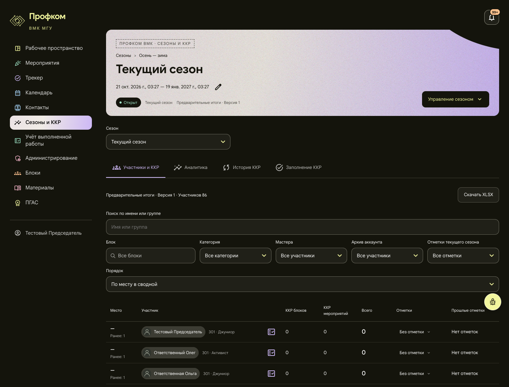
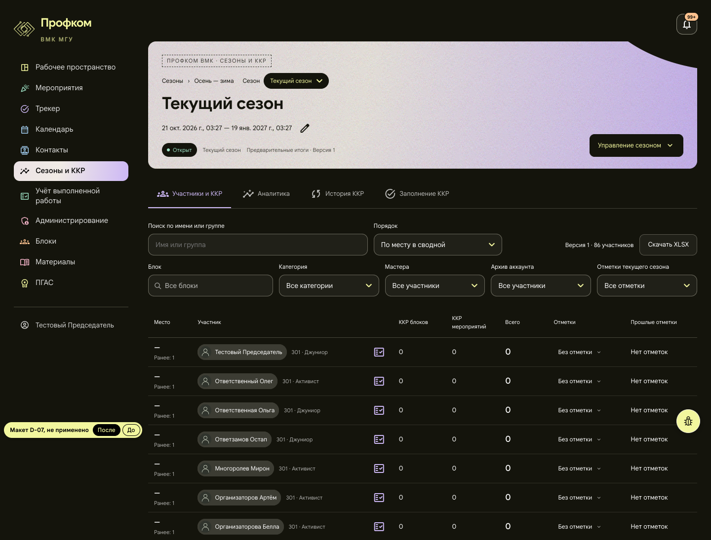
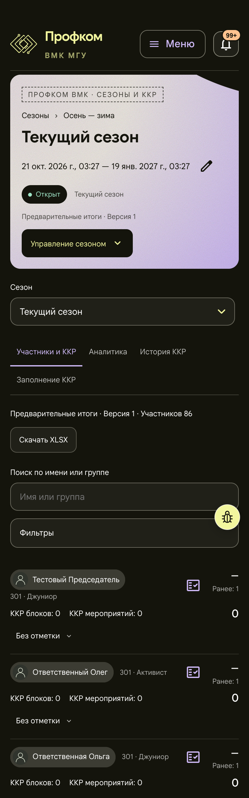
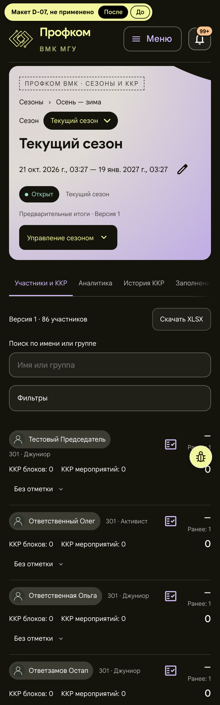

# D-07. Сезон: панель над сводной в две строки

Страница `/seasons/:id`, вкладка «Участники и ККР» (переключатель сезона общий для всех вкладок). Снимок — председатель, текущий сезон.

**Применено 2026-11-01**, см. раздел «Применено» в конце.

**Макет:** [mockup.html](mockup.html). В левом углу стоит пометка «Макет D-07, не применено» и переключатель «После / До». Адрес `mockup.html#before` сразу открывает старую страницу. Макет собран из снимка живой страницы (в папку не включён, «До» показывает его целиком): переставлены узлы, изменены сетка и отступы. Цвета, значки и шрифты взяты со страницы. Из текстов изменена только подпись над таблицей, см. «Риск».

## Проблема

Между шапкой и таблицей на 1440 px 520 px элементов управления: шапка кончается на y 328, таблица начинается на y 848. Под шапкой стоит отдельное поле «Сезон», хотя сезон уже назван в заголовке и крошках. Кнопка «Скачать XLSX» занимает целую строку. Поиск растянут на всю ширину, а «Порядок» вынесен отдельным рядом на всю ширину. На телефоне вкладки переносятся в две строки (89 px), «Заполнение ККР» оказывается одна внизу, а первый участник начинается на y 880.

## Предложение

- Переключатель сезона переезжает в строку крошек в шапке: «Сезоны › Осень — зима · Сезон [Текущий сезон ▾]». Он оформлен как кнопки шапки («Управление сезоном»), подпись «Выбранный сезон» сохраняется. Строка вкладок не меняется.
- Над таблицей две строки. В первой поиск (около 40 %), «Порядок», подпись «Версия 1 · 86 участников» и «Скачать XLSX». Во второй пять фильтров в один ряд.
- На телефоне вкладки идут одной строкой с горизонтальной прокруткой, правый край затухает как признак продолжения (это маска прозрачности, а не новый цвет). «Скачать XLSX» стоит в строке-сводке. Фильтры и «Порядок», как сейчас, спрятаны за кнопкой «Фильтры».

## Польза (замеры макета и снимка страницы, 2026-11-01)

| | Сейчас | Макет |
|---|---|---|
| 1440: элементы управления между шапкой и таблицей | 520 px (328 → 848) | 281 px (342 → 623) |
| 1440: первая строка таблицы | y 910 | y 685 (на 225 px выше) |
| 390: вкладки | 2 строки, 89 px | 1 строка, 45 px |
| 390: первый участник | y 880 | y 751 (на 129 px выше) |

Шапка становится чуть выше: на 14 px на 1440 и на 40 px на телефоне, где переключатель занимает свою строку. Это уже учтено в цифрах выше. При ширине от 360 до 1280 px горизонтальной прокрутки страницы нет. На 1024 px «Версия · XLSX» уходят на отдельную строку справа.

## Риск

- Переключатель в шапке должен работать на всех вкладках и сохранить `aria-label="Выбранный сезон"`: на него опирается `season-addresses.test.tsx`.
- «Порядок» рендерится в первой строке на широком экране и внутри «Фильтров» на телефоне. В макете это две копии. В коде это должен быть один элемент, место которого выбирает `matchMedia`. Компонент уже использует `matchMedia` для «Фильтров». `season-freeze.test.tsx` ищет `select[aria-label="Порядок"]`, поэтому его нужно перепроверить.
- Затухание у вкладок стоит снимать, когда прокрутка дошла до конца.
- В подписи над таблицей нет слов «Предварительные итоги»: они уже стоят в шапке («Предварительные итоги · Версия 1»). У утверждённой сводки подпись сейчас начинается с «Утверждено» и даты, а в шапке даты нет. Дату утверждения нужно оставить в подписи.

**Трудоёмкость:** S–M, 0,5–1 день. API не меняется.

## Файлы, если одобрить

- `frontend/src/pages/Workspace/SeasonPages.tsx`
- `frontend/src/pages/Workspace/SeasonParticipants.tsx`
- `frontend/src/pages/Workspace/SeasonWorkspace.module.css`
- `frontend/src/pages/Workspace/season-addresses.test.tsx`, перепроверить `season-freeze.test.tsx`

## До и после

Окно 1440 px и 390 px. Мобильные снимки сняты с плотностью 2×, поэтому файлы шириной 780 px. Высота среза та же, что у снимков «до».

| До | После |
|---|---|
|  |  |
|  |  |

**Применено, сайт после внедрения (2026-11-01):** [1440](applied-desktop.png) · [390](applied-mobile.png). Снимки всей страницы на стенде с синтетическими данными, та же страница и роль, что у «до», сборка `audit/design-integrate`. Плавающая кнопка «жучка» в этих снимках скрыта: снимок всей страницы рисует её там, где кончался первый экран, а на сайте она стоит в правом нижнем углу экрана.

## Применено (2026-11-01)
Ветка `audit/design-seasons`, коммит `c072165`.

На 1440 px сайт совпадает с видом «После» до пикселя:
- шапка занимает y 84 → 342;
- переключатель 132 × 32 px стоит в строке крошек;
- вкладки на y 368;
- панель в две строки на y 449, высотой 152 px: поиск 445 px, «Порядок» 260 px, подпись с XLSX, ниже «Фильтры»;
- таблица начинается на y 623, первая строка на y 685.

На 390 px вкладки идут одной строкой (y 481, 45 px), первый участник на y 751, тоже как в макете.

**Отступления от макета и почему.**
1. **«Порядок» — один элемент, а не две копии, как в макете.** Его место выбирает `matchMedia("(min-width: 769px)")`: на широком экране он стоит в первой строке, на телефоне внутри «Фильтров». Выбранное значение переживает смену ширины окна. На телефоне «Фильтры · N» по-прежнему его считает.
2. **Левый край вкладок тоже затухает, когда строка сдвинута от начала.** В макете затухает только правый край. Без левого после прокрутки до конца первая вкладка обрезалась краем без всякого признака. Правое затухание снимается в конце строки (риск из README).
3. **Текущая вкладка выходит из затухания.** Например, на последней вкладке «Заполнение ККР» строка на телефоне сдвигается так, чтобы её было видно целиком.
4. **Рамка фокуса вкладок на телефоне рисуется внутри ссылки** (`outline-offset: -2px`), иначе строка с прокруткой обрезала бы внешнюю рамку.
5. **Длинное название сезона переносится внутри переключателя** и не растягивает шапку. Поэтому скругление 16 px, а не «пилюля». На одной строке высотой 32 px вид тот же, а при переносе края остаются в рамке.
6. **У утверждённой сводки подпись начинается с «Утверждено <дата> · »** (риск из README). На 1440 px такая подпись длиннее, и она вместе с XLSX уходит на свою строку справа. Это то же правило, что в макете на 1024 px.
7. **Доступ не изменился.** Переключатель и вкладки по-прежнему видят только те, кому видна сводка (`view_summary`). У рядового участника нет ни того, ни другого.

**Риски из этого README.**
- Переключатель в шапке работает на всех четырёх вкладках и при смене сезона сохраняет вкладку. `aria-label="Выбранный сезон"` сохранён.
- `season-addresses.test.tsx` прошёл без изменений. В него добавлены тесты:
  - место переключателя для председателя, зама, `hrmaster` и `hrdeputy`;
  - его отсутствие у рядового участника;
  - затухание краёв;
  - выведение текущей вкладки из затухания.
- «Порядок»: см. отступление 1. `season-freeze.test.tsx` прошёл без изменений.
  - Его тест «visits a hundred decision disclosures…» и без этой правки идёт 11–13 с при пределе 15 с.
  - Под тяжёлой нагрузкой машины (load average 10–36 от параллельных агентов) он упал по времени в трёх из четырёх полных прогонов с правкой. Три прогона базового коммита в те же минуты прошли.
  - Попеременные отдельные прогоны дали одинаковое время с правкой и без неё: 10,9–11,8 с против 10,9–11,5 с. За одну итерацию правка перерисовывает лишь панель участников, и затраты на это ничтожны.
  - Полный прогон при обычной нагрузке прошёл: 1093 из 1093, этот тест занял 12,8 с.
- Затухание у вкладок: см. отступления 2–3.
- Подпись над таблицей: «Предварительные итоги» в ней нет, они стоят в шапке. Дата утверждения осталась, см. отступление 6. В `summary-table-layout.test.tsx` добавлены тесты:
  - порядок первой строки;
  - подпись утверждённой сводки;
  - «Порядок» внутри «Фильтров» на узком окне и его возврат при расширении.

**Проверено в браузере** на локальном стенде с синтетическими данными:
- состояния сезона: планируемый, текущий открытый, на подведении итогов, закрытый с утверждённой сводкой;
- роли: председатель, его зам, `hrmaster`, `hrdeputy`, рядовой участник;
- все четыре вкладки;
- ширины 360, 390, 768, 1024, 1280, 1440 и 1920 px.

Горизонтальной прокрутки нет, обрезанного текста нет. Работают:
- переключатель с клавиатуры, рамка фокуса на месте;
- «Порядок», поиск и «Скачать XLSX»;
- вкладки телефона одной строкой.

Кнопка «жучка» стоит в правом нижнем углу окна: 22 px от краёв на широком экране, 14 px на 360–768 px. Когда страница прокручена до конца, под кнопкой ничего нет.

**После проверки (2026-11-01), ветка `audit/design-integrate`.**
- **Порядок клавиатуры на телефоне** (коммит `906ba36`). Строка версии со «Скачать XLSX» стояла над поиском только за счёт CSS `order: -1`, а Tab шёл поиск → XLSX → «Фильтры». Теперь на телефоне она идёт первой и в разметке, Tab идёт XLSX → поиск → «Фильтры», как видно глазу. Вид не изменился: положение и размер каждого элемента панели совпадают с прежней сборкой на 360, 390, 768 и 1440 px.
- **Вкладки сезона не задерживают загрузку** (коммит `6e4a2a8`). Вкладки измеряли свою строку прямо при монтировании страницы, и браузер раскладывал всю новую страницу с таблицей до того, как уходил запрос итогов: на 80 мс задержки и CPU×4 готовность итогов была медленнее на 28–38 %. Теперь первые размеры приходят от `ResizeObserver`, а текущая вкладка измеряется в ближайшем кадре до отрисовки. Поведение вкладок на телефоне то же: текущая вкладка выводится из затухания, края затухают так же.
