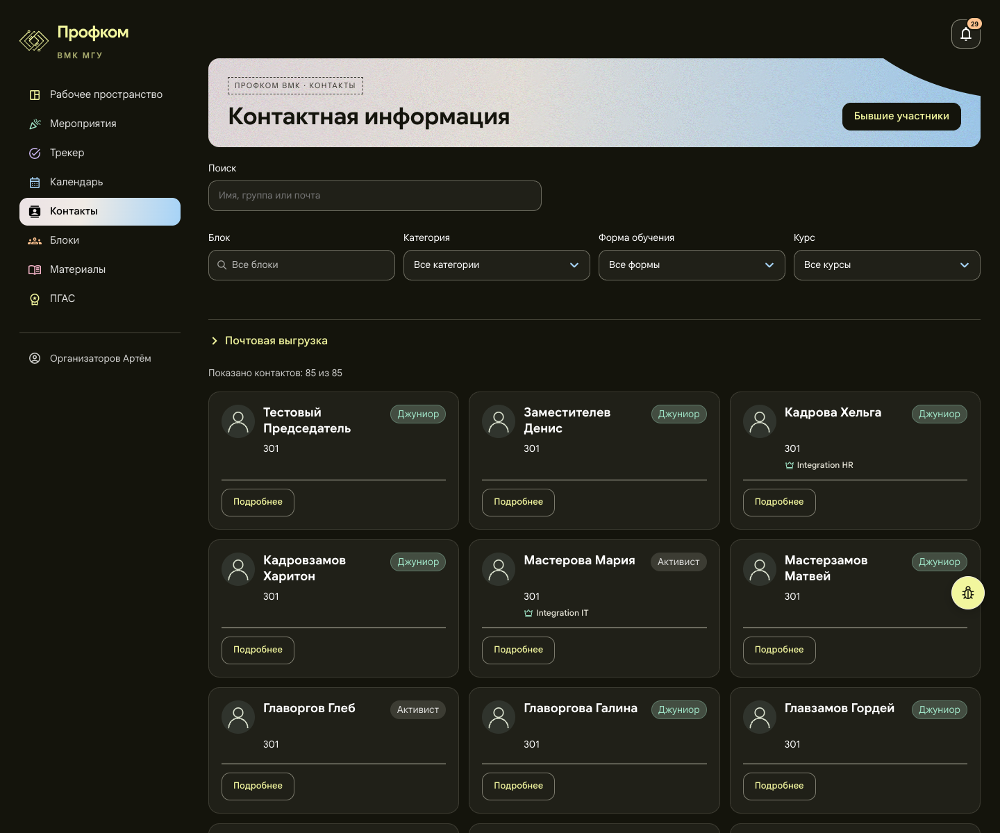
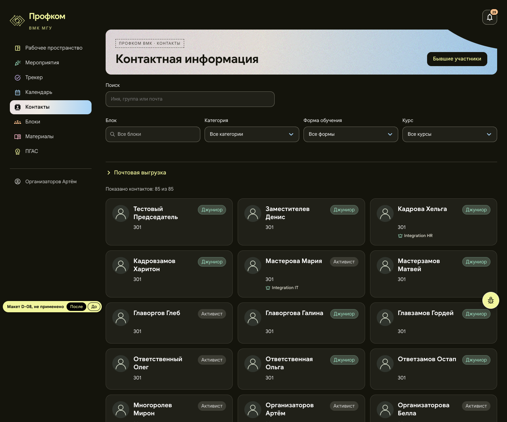
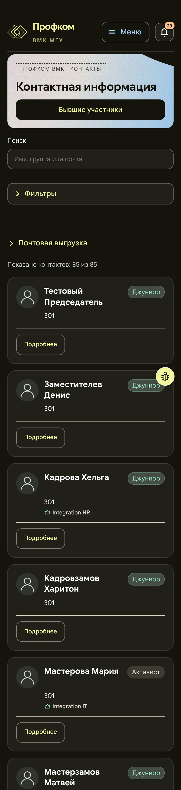
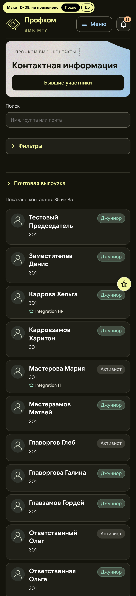

# D-08. Контакты: карточка без кнопки «Подробнее»

Страница `/contacts`, все роли. Снимок — организатор (org1), 85 контактов.

**Макет:** [mockup.html](mockup.html). Не применён к сайту. В левом углу стоит пометка «Макет D-08, не применено» и переключатель «После / До». Адрес `mockup.html#before` сразу открывает старую страницу. Макет собран из снимка живой страницы (в папку не включён, «До» показывает его целиком): убрана строка «Подробнее», изменены сетка и отступы. Цвета, бейджи, корона мастера (вариант F) и шрифты не менялись.

## Проблема

Около 65 px каждой карточки занимает отделённая линией строка с одной кнопкой «Подробнее». Она ведёт туда же, куда имя, а имя уже растянуто ссылкой на всю карточку. Из-за этого 85 контактов дают страницу 6 915 px на 1440 и 18 919 px на телефоне.

## Предложение

- Строка «Подробнее» убирается. Профиль открывается по имени и по любому месту карточки, как и сейчас. Ссылки на блоки остаются отдельными ссылками.
- «Управление аккаунтом» у управляющих становится небольшой текстовой кнопкой в правом нижнем углу той же карточки, без отдельной строки. У org1 этой кнопки нет, поэтому в макете её не видно.
- На 1440 остаются три колонки.
- На телефоне карточка превращается в строку списка: аватар 40 px, ФИО и группа, бейдж категории справа, блоки с короной мастера под именем.

## Польза (замеры макета и снимка страницы, 2026-11-01)

| | Сейчас | Макет |
|---|---|---|
| 1440: высота карточки (мин / сред / макс) | 182 / 203 / 216 px | 117 / 138 / 151 px |
| 1440: страница | 6 915 px | 5 030 px (−27 %) |
| 390: высота карточки (мин / сред / макс) | 186 / 201 / 220 px | 78 / 111 / 135 px |
| 390: страница | 18 919 px | 10 808 px (−43 %) |

Проверено в макете: правый нижний угол карточки открывает `/contacts/3`, а ссылка на блок внутри неё открывает `/blocks/…`. При ширине от 360 до 1280 px горизонтальной прокрутки нет.

## Риск

- Пропадает явная кнопка, а часть пользователей привыкла её искать. Подсказкой служит подсветка рамки при наведении, она уже есть.
- Кнопка «Управление аккаунтом» должна лежать поверх растянутой ссылки, как сейчас лежат ссылки на блоки.
- Тесты `directory-filters.test.tsx` и `ContactDialog.test.tsx` ищут «Подробнее».

**Трудоёмкость:** S, около 0,5 дня.

## Файлы, если одобрить

- `frontend/src/pages/Workspace/DirectoryPages.tsx`
- `frontend/src/pages/Workspace/DirectoryCards.module.css`
- `frontend/src/pages/Workspace/directory-filters.test.tsx`
- `frontend/src/components/Workspace/ContactDialog.test.tsx`

## До и после

Окно 1440 px и 390 px. Мобильные снимки сняты с плотностью 2×, поэтому файлы шириной 780 px. Высота среза та же, что у снимков «до».

| До | После |
|---|---|
|  |  |
|  |  |
