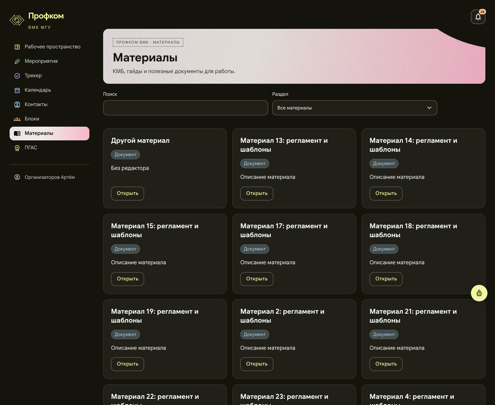
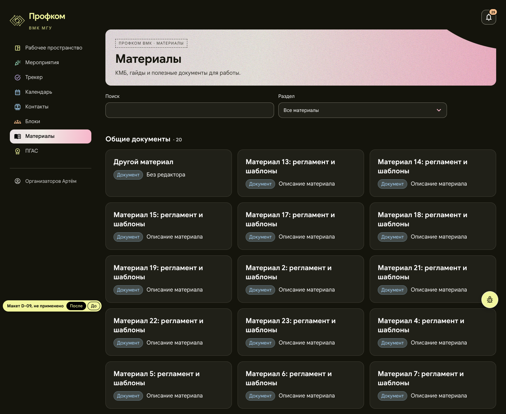
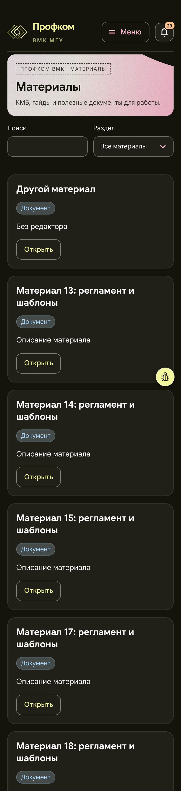
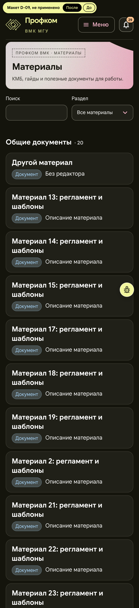

# D-09. Материалы: группы по разделам и карточка-ссылка

Страница `/materials`, все роли. Снимок — организатор (org1), 22 материала.

**Макет:** [mockup.html](mockup.html). Не применён к сайту. В левом углу стоит пометка «Макет D-09, не применено» и переключатель «После / До». Адрес `mockup.html#before` сразу открывает старую страницу. Макет собран из снимка живой страницы (в папку не включён, «До» показывает его целиком): карточки разложены по разделам, кнопка «Открыть» убрана, изменены сетка и отступы. Цвета, бейджи и шрифты не менялись.

## Проблема

21 опубликованный материал идёт одной сеткой из карточек по 233–284 px, у каждой своя кнопка «Открыть». Код уже сортирует материалы по разделам (КМБ → Общие документы → Гайды блоков), но границ разделов не видно: раздел различается только бейджем. Страница занимает 2 327 px на 1440 и 5 558 px на телефоне.

## Предложение

- При фильтре «Все материалы» карточки выводятся группами с заголовком и счётчиком: «КМБ», «Общие документы · 20», «Гайды блоков · 1». Порядок и сортировка по названию внутри групп остаются прежними, пустые группы не показываются (в этих данных пуст «КМБ»). Если раздел выбран фильтром, заголовков нет.
- Карточка целиком становится ссылкой: ссылка — само название, кнопка «Открыть» убирается. Бейджи, включая «Для участников блока», и одна строка описания стоят в одну линию, длинное описание обрезается многоточием.
- На 1440 остаются три колонки. Группа из одной карточки сохраняет ширину колонки, а не растягивается на всю ширину. На телефоне карточки становятся строками списка.
- «Гайды блоков в подготовке» остаются внизу, внутри те же короткие карточки.

## Польза (замеры макета и снимка страницы, 2026-11-01)

| | Сейчас | Макет |
|---|---|---|
| 1440: высота карточки (мин / сред / макс) | 233 / 240 / 284 px | 135 / 137 / 167 px |
| 1440: страница | 2 327 px | 1 879 px (−19 %) |
| 390: высота карточки (мин / сред / макс) | 177 / 224 / 254 px | 89 / 112 / 121 px |
| 390: страница | 5 558 px | 3 156 px (−43 %) |

Проверено в макете: клик в правую нижнюю часть карточки попадает в её ссылку. Карточка в «Гайдах в подготовке» тоже без «Открыть». При ширине от 360 до 1280 px горизонтальной прокрутки нет.

## Риск

- Заголовки групп дублируют фильтр «Раздел», поэтому при выбранном разделе их надо прятать.
- Пропадает явная кнопка «Открыть». Описание в одну строку обрезается, полный текст есть на странице материала.
- `material-navigation.test.tsx` берёт первый `h2` страницы как первый материал. Заголовки групп его опередят, поэтому тест нужно поправить, либо сделать названия карточек `h3`.

**Трудоёмкость:** S, около 0,5 дня.

## Файлы, если одобрить

- `frontend/src/pages/Workspace/MaterialPages.tsx`
- `frontend/src/pages/Workspace/MaterialCards.module.css`
- `frontend/src/pages/Workspace/material-navigation.test.tsx`

## До и после

Окно 1440 px и 390 px. Мобильные снимки сняты с плотностью 2×, поэтому файлы шириной 780 px. Высота среза та же, что у снимков «до».

| До | После |
|---|---|
|  |  |
|  |  |

## Применено (2026-11-01)

Коммит `eab7d59` в ветке `audit/design-lists`: «feat(layout): materials grouped by section, the whole card is its link (D-09, owner 2026-11-01)». Изменены `MaterialPages.tsx`, `MaterialCards.module.css` и тест `material-navigation.test.tsx`.

Как в макете «После»:
- При «Все материалы» карточки идут группами с заголовком и счётчиком: «КМБ», «Общие документы», «Гайды блоков». Пустые группы не показываются, порядок и сортировка по названию прежние.
- Карточка целиком ведёт на материал, кнопки «Открыть» нет. Бейджи и одна строка описания стоят в одну линию.
- Сетка `auto-fill`: группа из одной карточки сохраняет ширину колонки.
- На телефоне карточки становятся строками списка: поля 14/16 px, промежуток 8 px.
- «Гайды блоков в подготовке» по-прежнему внизу.

Замеры на стенде для org1 совпали с макетом на всех ширинах: на 1440 карточки 135 / 137 / 167 px и страница 1 879 px, на 390 — 89 / 112 / 121 px и 3 156 px.

Решения по рискам и отличия от макета:
- **Заголовки групп при выбранном разделе.** Они скрыты: раздел и так назван фильтром.
- **Уровни заголовков.** В макете названия карточек были `h2`, как и заголовки групп. Сделано так: группа — `h2`, название карточки в ней — `h3`. Без групп (выбран раздел) и в «Гайдах в подготовке» названия остаются `h2`. Размер шрифта задан явно, поэтому `h3` выглядит так же, как в макете. Сетка группы — `role="group"` с подписью по её заголовку. Тест `material-navigation.test.tsx` теперь ищет первую карточку по `h3`.
- **Описание в одну строку.** На карточке оно обрезается многоточием. Полный текст остаётся в разметке и служит описанием ссылки (`aria-describedby`), поэтому экранный диктор читает его целиком. Глазами полный текст виден на странице материала. Пустое описание не оставляет пустой строки (в макете там был пустой `
`).
- **Неизвестный вид материала.** Сервер отдаёт только `kmb`, `general` и `guide`, но фронтенд принимает любую строку. Материал неизвестного вида попадает в «Общие документы», как и его бейдж «Документ», и не пропадает из сгруппированного вида.
- **Тест редактора в том же файле.** Он ждал только затишья кэша, а редактор загружается лениво, поэтому тест падал примерно в 1 запуске из 4. Теперь тест ждёт появления формы.

Проверено на локальном стенде (сборка этой ветки): ширины 360, 390, 768, 1024, 1280, 1440 и 1920 px, роли chair, org1 и outsider. Горизонтальной прокрутки нет. Попадания по точкам: углы и середина карточки ведут на её материал. Клавиатура доходит до ссылки-названия, вокруг карточки рисуется одно кольцо фокуса. Кнопка «жучка» стоит в правом нижнем углу окна, в конце страницы под ней ничего нет. Снимки сделаны только в пределах окна.
